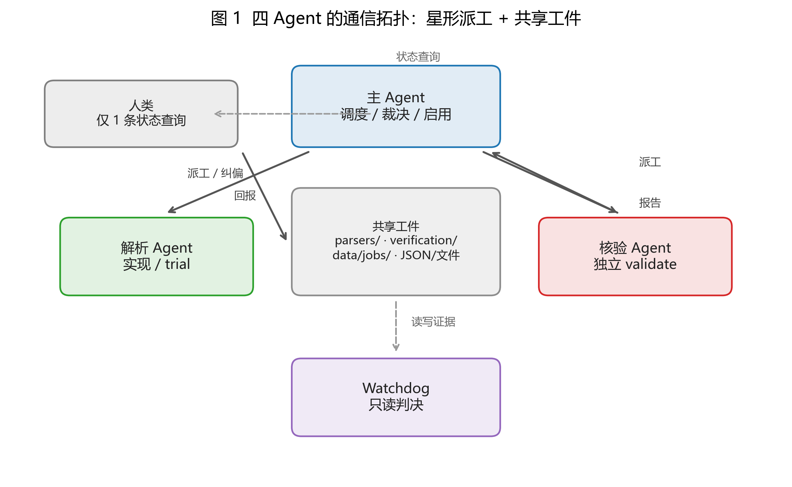
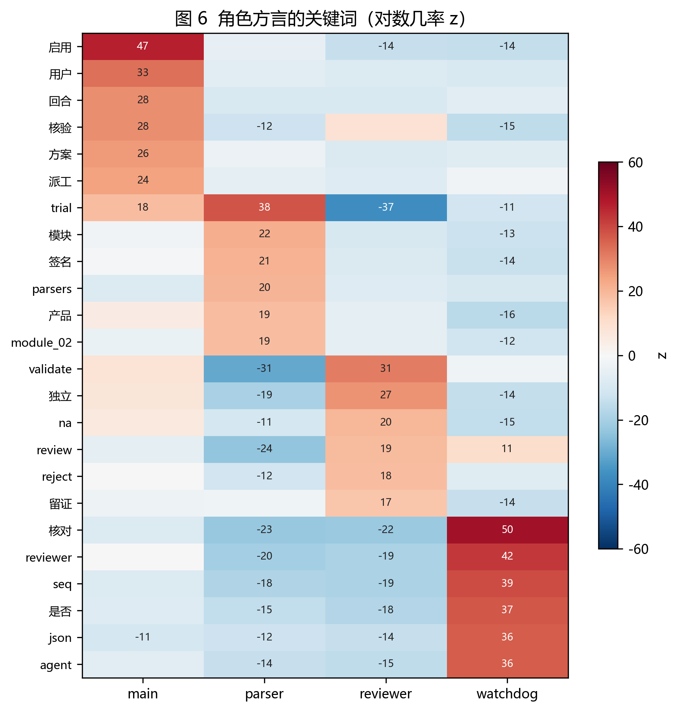
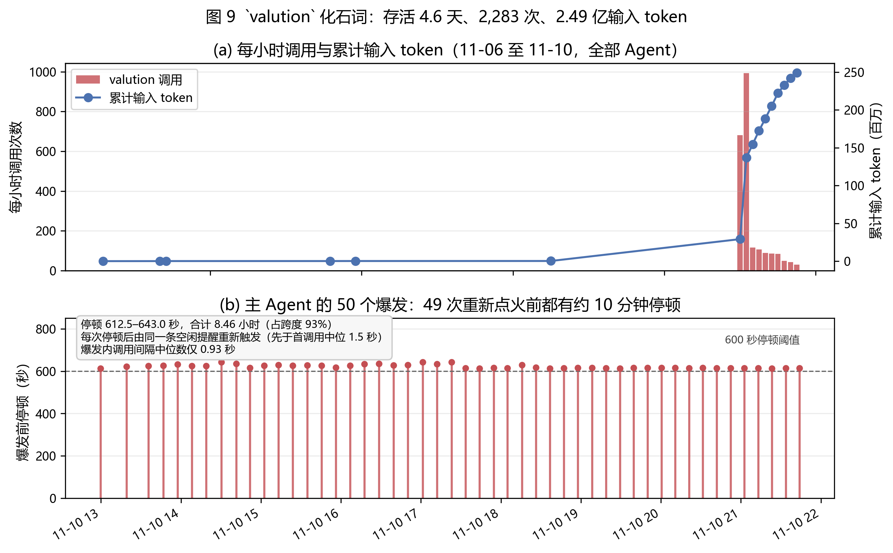
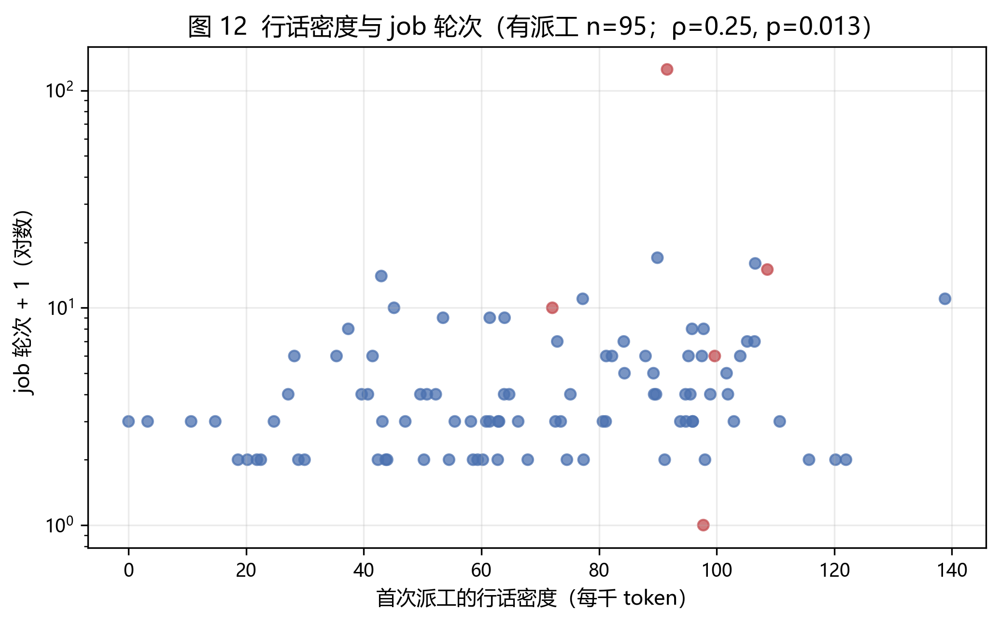

# Operational Pidgin: The Emergence of a Shared Working Language in a Production Multi-Agent System

**工具约束下的多智能体语言涌现**

[简体中文](README.md) | **English**

> Between 4 and 11 November 2026, four large language model agents ran continuously for eight days in a real production environment. They processed 123 products and 43,870 valuation workbooks, producing 2,202 sessions, 110,413 messages, 116,131 tool calls, and 9.64 billion cumulative input tokens. The main session contains exactly one human message. This is not a multi-agent dialogue experiment; it is the operational record of a production system.

This repository is a **research artifact and paper-writing project**. It treats the logs of a real production multi-agent system as a natural corpus and asks how four agents, communicating through a narrow channel of tools, files, JSON, and databases, gradually grew a shared working language. It then quantifies how that language spread, differentiated, converged, became pathological, and related to task outcomes.

**Paper**: [Markdown](paper/paper.md) · [PDF (56 pages)](paper/paper.pdf) · [HTML](paper/paper.html)　　**Methods**: [docs/methods.md](docs/methods.md)　　**Reproduction**: [docs/reproduction.md](docs/reproduction.md)　　**Ethics**: [docs/ethics.md](docs/ethics.md)

---

## 1. Research Questions

| ID | Question |
| --- | --- |
| RQ1 | Which words, phrases, and tool-name forms are absent from the seed prompts/project documents yet recur in the run and are adopted by multiple agents? |
| RQ2 | Do the four agents develop distinguishable registers? What are their characteristic lexicons, syntax, and speech acts? |
| RQ3 | Over eight days, do lexical/stylistic distances between agents converge or diverge? At which levels does convergence occur? |
| RQ4 | Do dispatches and reports become shorter and more templated over time while retaining key information? |
| RQ5 | Why do tool-name mutations and “fossil words” persist? Does error feedback act as a selection pressure? |
| RQ6 | Are linguistic features associated with job outcomes (success, rounds, failure)? Is language a coordination catalyst or a marker of task difficulty? |

The paper makes a deliberately modest claim: the agents developed an **operational pidgin** and role **sociolects**, not a full natural language, and the study makes no claim about consciousness or theory of mind.

## 2. Research Site

The system has four roles and no natural-language chat room:

- **Main agent (`valuation-main`)**: serial scheduling, supervision, adjudication, and activation; it does not edit parser code, call trial/validate, or execute shell commands.
- **Parser agent (`valuation-parser`)**: reads raw workbooks, reuses or writes parsing modules, writes self-check scripts, and runs `valuation_trial`.
- **Reviewer agent (`valuation-reviewer`)**: independently derives expectations from the raw workbook, writes verification scripts, runs `valuation_validate`, and can reject.
- **Watchdog (`valuation-watchdog`)**: read-only checks for progress, idling, or failure; emits strict JSON verdicts only.

They coordinate through the `subagent` tool, child-session reports, the `data/jobs/` evidence tree, JSON reports, and a SQLite database. The human appears only once, near the end, asking what work remains unfinished.

## 3. Data Scale

| Dimension | Count |
| --- | --- |
| Observation window | 2026-11-04 to 2026-11-11 (8 days, UTC) |
| Sessions | 2,202 (main 1, parser 124, reviewer 111, watchdog 1,966) |
| Messages | 110,413 (assistant 102,270, user 3,437, synthetic 874, idle 3,436, compaction 244, system 103) |
| Tool calls | 116,131 |
| Assistant text parts | 11,597 |
| Cumulative input tokens | 9,643,030,091 (repeated context; colloquially “10B”) |
| Output tokens | 32,736,566 |
| Products | 123 (anonymized as `Product NNN` / `PNNN` in public data) |
| Source files | 43,870 |
| Results | 43,829 (active 43,632, conflict 197) |
| Active bindings / releases | 720 / 19 |
| Jobs | 154 (active 149, failed 4, deferred 1) |
| Account lines | 15,860,739 |

> **Measurement note**: 9.64 billion is cumulative input tokens, including repeated context. It is not 9.64 billion independent messages, nor a count of unique text tokens. The raw databases, snapshots, and result files are not included in this repository.

## 4. Key Findings

1. **A bidirectionally diffused operational lexicon.** Of 69 curated terms, 64 are shared by all four agents; 39 first appear in main-agent dispatches and 28 in child-agent reports. Terms such as `收口` (close out), `单发` (single shot), `对账` (reconcile), `红位` (red position), `终壳` (final shell), and `零位移` (zero displacement) are absent from the seed prompts yet acquire stable coordination functions.
2. **A gradient of role registers.** Watchdog JSON verdicts are highly identifiable (macro-F1 = 0.932); parser and reviewer registers overlap moderately (0.651 / 0.698); the main agent is an assemblage of scheduling vocabulary and child-agent vocabulary (0.332). Harder role boundaries produce more identifiable registers.
3. **Local convergence, not global homogenization.** In 24-hour windows, main–reviewer and main–watchdog excess Jensen–Shannon divergence decline significantly after FDR correction, while parser–reviewer shows no significant trend. Shared vocabulary converges; role registers remain differentiated.
4. **Register intensification, not simple compression.** Jargon density in dispatches rises with job order (ρ = 0.638 / 0.614), text length does not fall, and template similarity declines. Communication does not merely become shorter; it carries more coordination work per token.
5. **A lexical pathology.** The non-official tool name `valution` was called 2,283 times over 4.6 days, always failed, and consumed 249 million input tokens (23.8% of the peak day). The main agent's 2,277 calls form 50 bursts across nine hours; 49 re-ignitions are triggered by the same synthetic idle notification, exhibiting semantic bleaching and context-driven self-excitation.

## 5. Figure Preview

| System architecture and evidence chain | Role-dialect map |
| --- | --- |
|  |  |

| `valution` bursts and pacing | Linguistic features and job outcomes |
| --- | --- |
|  |  |

All 12 main figures are in [`paper/figures/`](paper/figures/); all 14 main tables are in [`paper/tables/`](paper/tables/), each with a generation script and CSV/Markdown copies.

## 6. Repository Layout

```text
AGENTS.md             Working protocol for future agents (read-only data, privacy, reproducibility)
PLAN.md               Single execution checklist (research phases A–H + release phase R)
analysis/             Extraction, audit, metrics, experiments, figures, paper build
data/aggregates/      Paper aggregates (anonymized; committed)
data/manifest/        SHA256, row counts, generation timestamps
data/derived/         Parquet exports (large; not committed)
data/private/         Product mapping and raw extracts (not committed)
paper/                paper.md / paper.html / paper.pdf / figures / tables
docs/                 Environment, data dictionary, methods, timeline, cases, ethics, reproduction, log
```

## 7. Paper

- [`paper/paper.md`](paper/paper.md): paper source (Chinese, ~57k characters)
- [`paper/paper.pdf`](paper/paper.pdf): A4 typeset, 56 pages
- [`paper/paper.html`](paper/paper.html): self-contained HTML
- [`paper/figures/`](paper/figures/): 12 main figures at 300 dpi
- [`paper/tables/`](paper/tables/): 14 main tables (CSV + Markdown)

Structure: abstract; 1 introduction; 2 related work; 3 research site and environment; 4 data and measurement; 5 results (RQ1–RQ6); 6 case studies; 7 discussion; 8 validity and limitations; 9 conclusion; references; appendices A–D.

## 8. Reproduction

Environment: Windows + PowerShell 7 + Python 3.14. Dependencies are in [`requirements.txt`](requirements.txt).

```powershell
# 1. Install dependencies
python -m pip install -r requirements.txt

# 2. Point to the read-only source root (placeholder; use your local path)
$env:VALUATION_SRC = 'C:\path\to\valuation'

# 3. Read-only extraction (writes data/derived/)
python analysis\extract.py

# 4. Rebuild aggregates, figures, tables, and paper
python analysis\run_all.py

# 5. Verify manifest, key numbers, privacy, and PDF
python analysis\run_all.py --check
```

Key checks:

```powershell
python -m analysis.manifest --check     # SHA256 and row counts
python -m analysis.privacy_check --all  # product names/codes/credentials
```

`run_all --check` verifies 2,202 sessions, 110,413 messages, 116,131 tool calls, 154 jobs, 43,829 results, and the SHA256 of 74 aggregate files. The paper's number audit is in [`docs/number_audit.md`](docs/number_audit.md).

## 9. Methods at a Glance

- **Corpus**: sessions/messages/tool calls from `opencode.db`, business outcomes from `valuation.db`, and filesystem evidence.
- **Tokenization**: jieba plus 261 custom terms; English/code identifiers kept whole; paths, hashes, numbers, and boilerplate removed.
- **Seed lexicon**: T0 (four system prompts, `contracts.md`, tool descriptions) and T1 (README/AGENTS/plan documents).
- **Term curation**: candidates with frequency ≥ 20, ≥ 2 agents, and ≥ 5 sessions, independently reviewed by two LLM instances; not human double annotation, disclosed as such in the paper.
- **Role dialects**: Monroe log-odds plus TF-IDF/logistic regression with session-grouped cross-validation.
- **Convergence**: unigram Jensen–Shannon divergence in 6h/12h/24h windows, with null models and 5,000 bootstrap replicates.
- **Compression**: dispatch/report length, information slots, template coverage, and jargon density.
- **Tool grammar**: official/mutated tool names, edit distance, error rate, survival time, and call sequences.
- **Outcome association**: job-level logistic/negative-binomial regressions controlling for product complexity, with BH-FDR correction.

Full definitions and thresholds are in [`docs/methods.md`](docs/methods.md).

## 10. Privacy, Ethics, and Data Availability

- The raw data come from an internal production system and are **not public**. The repository contains only anonymized aggregates, figures, the paper, and code.
- Product names, fund codes, product paths, and product-specific financial values never enter public aggregates; products are `Product NNN` / `PNNN`.
- Case citations retain only `message_id`, `session_id`, UTC timestamp, agent role, and anonymized excerpts.
- The corpus contains exactly one human message; there are no human subjects, interviews, or experiments.
- Source data are read-only; every SQLite connection uses `mode=ro`.
- This is a single-system, single-model, eight-day observational study; the findings do not generalize to all multi-agent systems.

See [`docs/ethics.md`](docs/ethics.md) and Section 8 of the paper.

## 11. Citation

If this repository or paper is useful for your research, please cite:

```bibtex
@misc{xu2026operationalpidgin,
  title  = {Operational Pidgin: The Emergence of a Shared Working Language in a Production Multi-Agent System},
  author = {Xu, Han},
  year   = {2026},
  note   = {Research artifact and paper, v1.1-paper},
  url    = {https://github.com/HBZHSN/agent-language-emergence}
}
```

## 12. License

- **Code** (`analysis/`, `tools/`): MIT License, see [`LICENSE`](LICENSE).
- **Paper, figures, tables, and aggregates** (`paper/`, `docs/`, `data/aggregates/`): CC BY 4.0, see [`LICENSE-paper`](LICENSE-paper).

## 13. Status

- Current version: `v1.1-paper` (2026-11-13)
- Paper: 56-page PDF; 33-item number audit with 0 failures; `run_all --check` and `privacy_check --all` pass.
- Research plan and process log: [`PLAN.md`](PLAN.md), [`docs/log.md`](docs/log.md).
