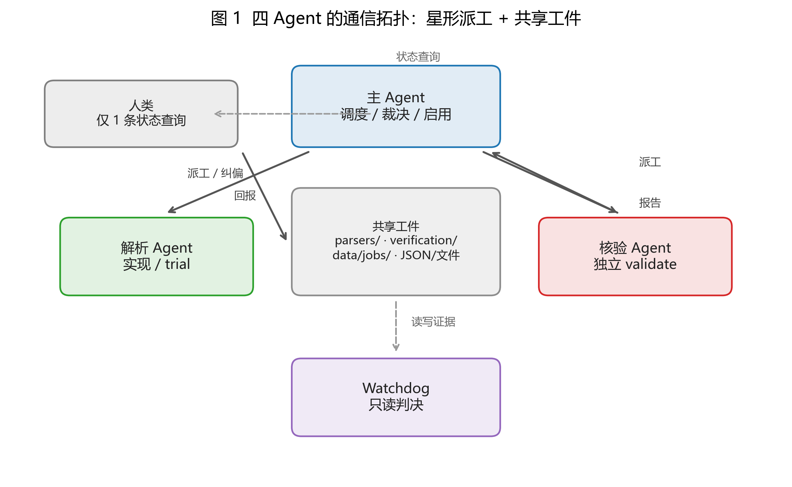
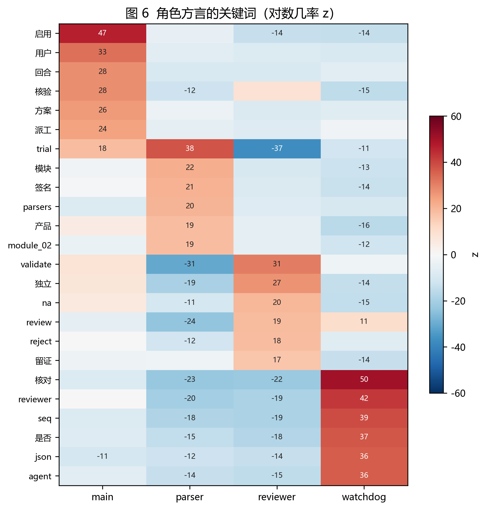
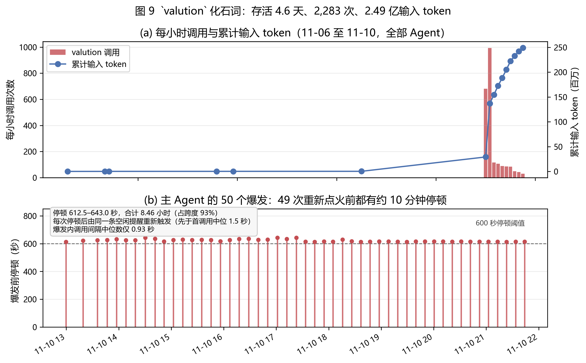
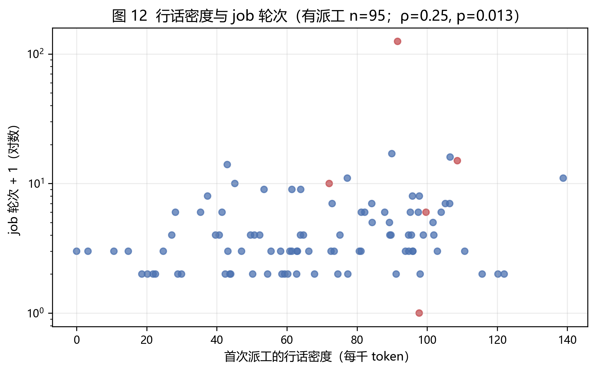

# 工具约束下的多智能体语言涌现

**Operational Pidgin: The Emergence of a Shared Working Language in a Production Multi-Agent System**

[English](README.en.md) | **简体中文**

> 2026-11-04 至 2026-11-11，四个大语言模型 Agent 在真实生产环境中连续运行 8 天，处理 123 个产品、43,870 份估值表，留下 2,202 个会话、110,413 条消息、116,131 次工具调用与 96.4 亿累计输入 token。主会话中只有 1 条人类消息。这不是一次多 Agent 对话实验，而是一套生产系统的运行记录。

本项目是一项**实证研究 + 论文写作**工程：把一套真实生产级多智能体系统的运行日志当作自然语料，研究四个 Agent 如何在工具、文件、JSON 与数据库构成的窄带通信中，逐步长出一套共享的工作语言，并量化这套语言如何扩散、分化、收敛、病化，以及它与任务结果的关系。

**论文**：[Markdown](paper/paper.md) · [PDF（56 页）](paper/paper.pdf) · [HTML](paper/paper.html)　　**方法**：[docs/methods.md](docs/methods.md)　　**复现**：[docs/reproduction.md](docs/reproduction.md)　　**伦理**：[docs/ethics.md](docs/ethics.md)

---

## 1. 研究问题

| 编号 | 问题 |
| --- | --- |
| RQ1 | 哪些词、短语和工具名形式不在种子提示词/项目文档中，却在运行中反复出现并被多个 Agent 采用？ |
| RQ2 | 四个 Agent 是否形成可区分的语域（register）？各自的词汇、句法、言语行为是什么？ |
| RQ3 | 8 天内 Agent 之间的词汇/风格距离是收敛还是分化？收敛发生在哪些层面？ |
| RQ4 | 派工与回报是否随时间变短、变模板化，同时保留关键信息？ |
| RQ5 | 工具名变异和“化石词”为什么能持续？错误反馈是否构成选择压力？ |
| RQ6 | 语言特征与 job 结果（成功、轮次、失败）是否相关？语言是协调的催化剂，还是任务难度的标记？ |

论文的谨慎主张是：这些 Agent 形成的是一套**操作性混合语（operational pidgin）**与**角色社会方言（sociolect）**，不是完整自然语言，也不涉及意识或心智理论。

## 2. 研究现场

系统由四个角色组成，它们之间没有自然语言聊天室：

- **主 Agent（valuation-main）**：串行调度、督导、裁决、启用；不编辑解析代码，不调用 trial/validate，不执行 shell。
- **解析 Agent（valuation-parser）**：读取原始估值表，复用或编写解析模块，写自检脚本，运行 `valuation_trial`。
- **核验 Agent（valuation-reviewer）**：独立从原表确定期望，写核验脚本，运行 `valuation_validate`，可以驳回。
- **Watchdog（valuation-watchdog）**：只读检查任务是否正常推进、空转或故障，只输出严格 JSON 判决。

它们通过 `subagent` 工具派工、子会话报告、`data/jobs/` 证据目录、JSON 报告和 SQLite 数据库协作。人类只在最后出现一次，问：“现在还有哪些任务没有完成”。

## 3. 数据规模

| 维度 | 数量 |
| --- | --- |
| 观察窗口 | 2026-11-04 至 2026-11-11（8 天，UTC） |
| 会话 | 2,202（main 1、parser 124、reviewer 111、watchdog 1,966） |
| 消息 | 110,413（assistant 102,270、user 3,437、synthetic 874、idle 3,436、compaction 244、system 103） |
| 工具调用 | 116,131 |
| assistant 文本片段 | 11,597 |
| 累计输入 token | 9,643,030,091（上下文重复计费口径，口语称 10B） |
| 输出 token | 32,736,566 |
| 产品 | 123（公开数据中脱敏为 `Product NNN` / `PNNN`） |
| 源文件 | 43,870 |
| 结果 | 43,829（active 43,632、conflict 197） |
| active binding / release | 720 / 19 |
| job | 154（active 149、failed 4、deferred 1） |
| 科目明细 | 15,860,739 行 |

> **口径说明**：96.4 亿是累计输入 token，包含重复上下文；不是 96.4 亿条独立消息，也不是唯一文本 token。原始数据库、快照与结果文件不进入本仓库。

## 4. 主要发现

1. **双向扩散的操作性词表。** 69 个经审定的词项中，64 个被四个 Agent 共用；39 个先现于主 Agent 派工，28 个先现于子 Agent 报告。`收口`、`单发`、`对账`、`红位`、`终壳`、`零位移` 等词不在种子提示词中，却获得了稳定的协调功能。
2. **梯度式角色方言。** Watchdog 的 JSON 判决语域高度可识别（macro-F1 = 0.932）；解析与核验语域中度重叠（0.651 / 0.698）；主 Agent 是调度语汇与子 Agent 语汇的拼装体（0.332）。角色边界越硬，语域越可识别。
3. **局部收敛而非整体趋同。** 24 小时窗下，主—核验、主—Watchdog 的超额 Jensen–Shannon 散度显著下降（通过 FDR 校正），解析—核验没有显著趋势。共享词汇在收敛，角色语域仍保持分化。
4. **语域强化而非简单压缩。** 派工行话密度随 job 顺序上升（ρ = 0.638 / 0.614），文本长度没有下降，模板相似度反而下降。通信不是单纯变短，而是“用更少的词承担更多的协调功能”。
5. **一个词汇病理案例。** 非官方工具名 `valution` 在 4.6 天内被调用 2,283 次、全部失败、消耗 2.49 亿输入 token（占峰值日 23.8%）。主 Agent 的 2,277 次调用构成跨 9 小时的 50 个爆发，其中 49 次由同一条系统空闲提醒重新触发，呈现语义漂白与上下文自激。

## 5. 图表预览

| 系统架构与证据链 | 角色方言地图 |
| --- | --- |
|  |  |

| `valution` 的爆发与起搏结构 | 语言特征与 job 结果 |
| --- | --- |
|  |  |

全部 12 幅主图在 [`paper/figures/`](paper/figures/)，14 张主表在 [`paper/tables/`](paper/tables/)，每幅图/表都有生成脚本和 CSV/Markdown 双份。

## 6. 仓库结构

```text
AGENTS.md             面向后续 Agent 的工作协议（数据只读、脱敏、复现规范）
PLAN.md               唯一执行清单（A–H 研究阶段 + R 发布阶段）
analysis/             抽取、审计、指标、实验、绘图、论文构建脚本
data/aggregates/      论文用聚合 CSV/JSON（已脱敏，提交）
data/manifest/        SHA256、行数、生成时间清单
data/derived/         源库导出的 parquet（大文件，不提交）
data/private/         产品映射与完整数据（不提交）
paper/                paper.md / paper.html / paper.pdf / figures / tables
docs/                 环境、数据字典、方法、时间线、案例、伦理、复现、日志
```

## 7. 论文

- [`paper/paper.md`](paper/paper.md)：论文源文件（中文，约 5.7 万字符）
- [`paper/paper.pdf`](paper/paper.pdf)：A4 排版，56 页
- [`paper/paper.html`](paper/paper.html)：自包含 HTML
- [`paper/figures/`](paper/figures/)：12 幅 300 dpi 主图
- [`paper/tables/`](paper/tables/)：14 张主表（CSV + Markdown）

论文结构：摘要；1 引言；2 相关工作；3 研究现场与环境；4 数据与测量；5 结果（RQ1–RQ6）；6 案例研究；7 讨论；8 有效性与局限；9 结论；参考文献；附录 A–D。

## 8. 复现

环境：Windows + PowerShell 7 + Python 3.14。依赖见 [`requirements.txt`](requirements.txt)。

```powershell
# 1. 安装依赖
python -m pip install -r requirements.txt

# 2. 指向只读源数据根目录（占位符，按本地实际路径设置）
$env:VALUATION_SRC = 'C:\path\to\valuation'

# 3. 只读抽取（生成 data/derived/）
python analysis\extract.py

# 4. 全量重建聚合、图、表、论文
python analysis\run_all.py

# 5. 校验 manifest、关键数字、隐私与 PDF
python analysis\run_all.py --check
```

关键校验：

```powershell
python -m analysis.manifest --check     # SHA256 与行数
python -m analysis.privacy_check --all  # 产品名/代码/凭据扫描
```

`run_all --check` 会核对 2,202 sessions、110,413 messages、116,131 tool calls、154 jobs、43,829 results，以及 74 个聚合文件的 SHA256；论文数字对账见 [`docs/number_audit.md`](docs/number_audit.md)。

## 9. 方法一览

- **语料**：`opencode.db` 的会话/消息/工具调用 + `valuation.db` 的业务结果 + 文件系统证据。
- **分词**：jieba + 261 个自定义词；英文/代码标识符整体保留；路径、哈希、数字、模板句清洗。
- **种子词表**：T0（四个系统提示词、`contracts.md`、工具描述）与 T1（README/AGENTS/方案）。
- **词项审定**：频次 ≥ 20、≥ 2 个 Agent、≥ 5 个 session 的候选，经两个 LLM 实例独立审读；不是人类双标注，论文如实披露。
- **角色方言**：Monroe 对数几率比 + TF-IDF/逻辑回归，按 session 分组交叉验证。
- **收敛**：6h/12h/24h 窗口的 unigram Jensen–Shannon 散度，带零模型与 bootstrap 5,000 次。
- **压缩**：派工/回报长度、信息槽位、模板覆盖率、行话密度。
- **工具语法**：官方/变异工具名、编辑距离、错误率、存活时间、调用序列。
- **结果关联**：job 级 logistic/负二项回归，控制产品复杂度，BH-FDR 校正。

完整口径与阈值见 [`docs/methods.md`](docs/methods.md)。

## 10. 隐私、伦理与数据可用性

- 原始数据来自一套内部生产系统，**不公开**；公开仓库只包含脱敏聚合、图表、论文与代码。
- 产品名、基金代码、产品路径与产品-specific 财务值不进入公开聚合；产品统一为 `Product NNN` / `PNNN`。
- 机构名与解析模块名统一为 `module_NN`（变体 `module_NNx`）；原始映射只存于不公开的 `data/private/`。
- 案例引用只保留 `message_id`、`session_id`、UTC 时间、Agent 角色与脱敏片段。
- 全库只有 1 条人类消息，不涉及人类受试者、访谈或实验。
- 源数据只读；所有 SQLite 连接使用 `mode=ro`。
- 研究是单系统、单模型、8 天观察窗口；结论不能外推到所有多智能体系统。

详见 [`docs/ethics.md`](docs/ethics.md) 与论文第 8 节。

## 11. 引用

如果本仓库或论文对你的研究有帮助，请引用：

```bibtex
@misc{xu2026operationalpidgin,
  title  = {工具约束下的多智能体语言涌现：基于一套生产级 Agent 系统 96.4 亿输入 token 的实证研究},
  author = {Xu, Han},
  year   = {2026},
  note   = {Research artifact and paper, v1.1-paper},
  url    = {https://github.com/HBZHSN/agent-language-emergence}
}
```

## 12. 许可

- **代码**（`analysis/`、`tools/`）：MIT License，见 [`LICENSE`](LICENSE)。
- **论文、图表、表格与聚合数据**（`paper/`、`docs/`、`data/aggregates/`）：CC BY 4.0，见 [`LICENSE-paper`](LICENSE-paper)。

## 13. 状态

- 当前版本：`v1.1-paper`（2026-11-13）
- 论文：56 页 PDF；数字对账 33 项、0 失败；`run_all --check` 与 `privacy_check --all` 通过。
- 研究计划与过程记录：[`PLAN.md`](PLAN.md)、[`docs/log.md`](docs/log.md)。
