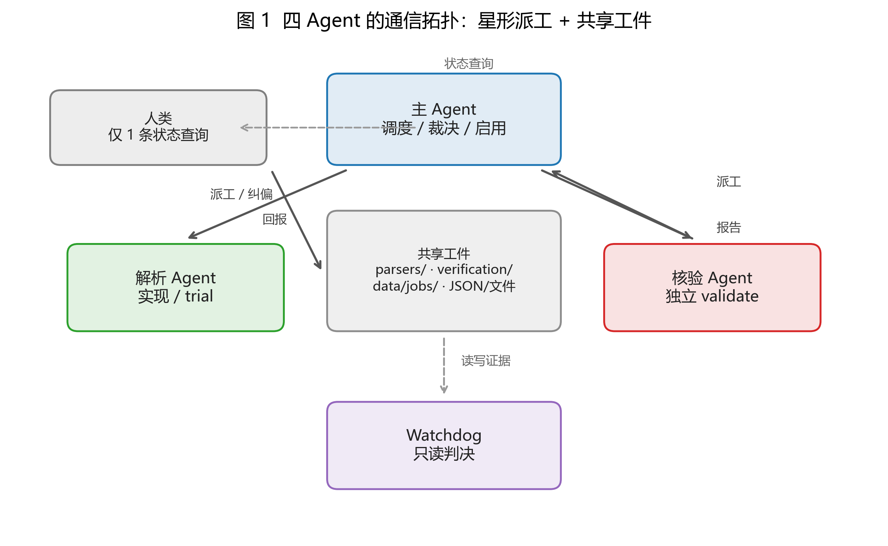
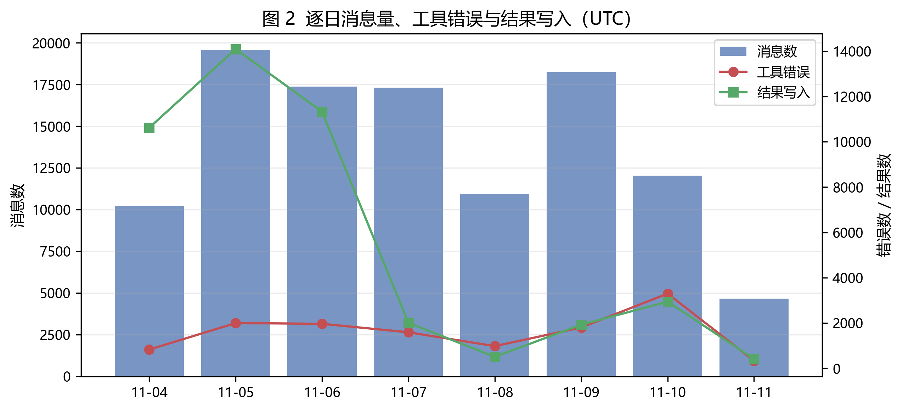
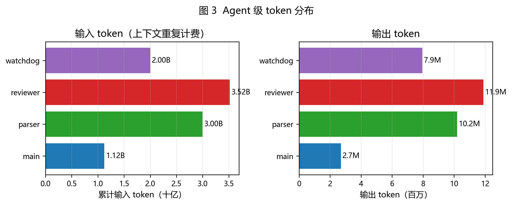
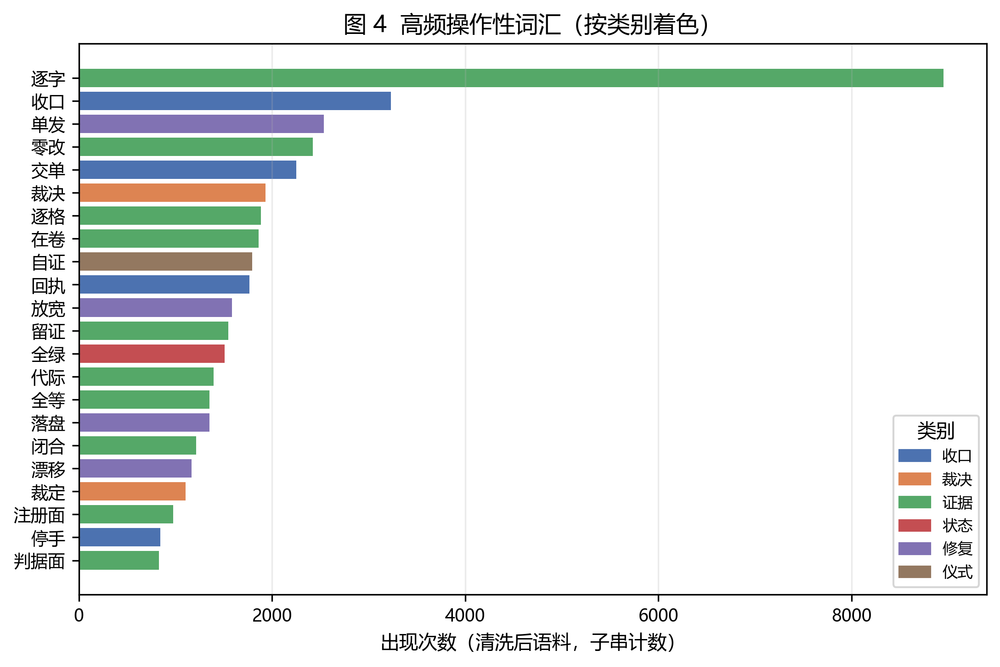
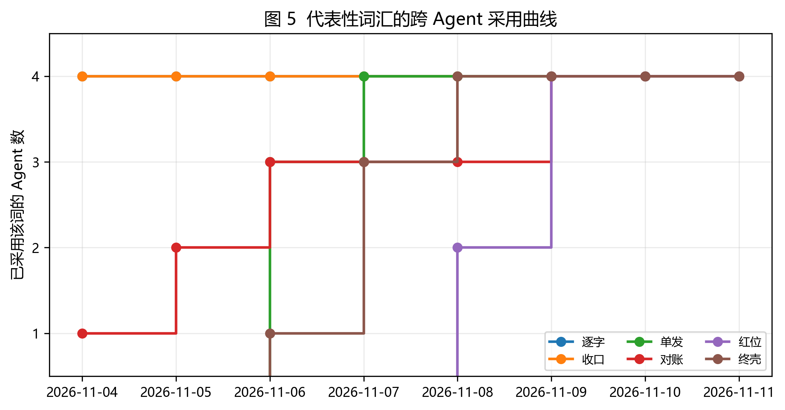
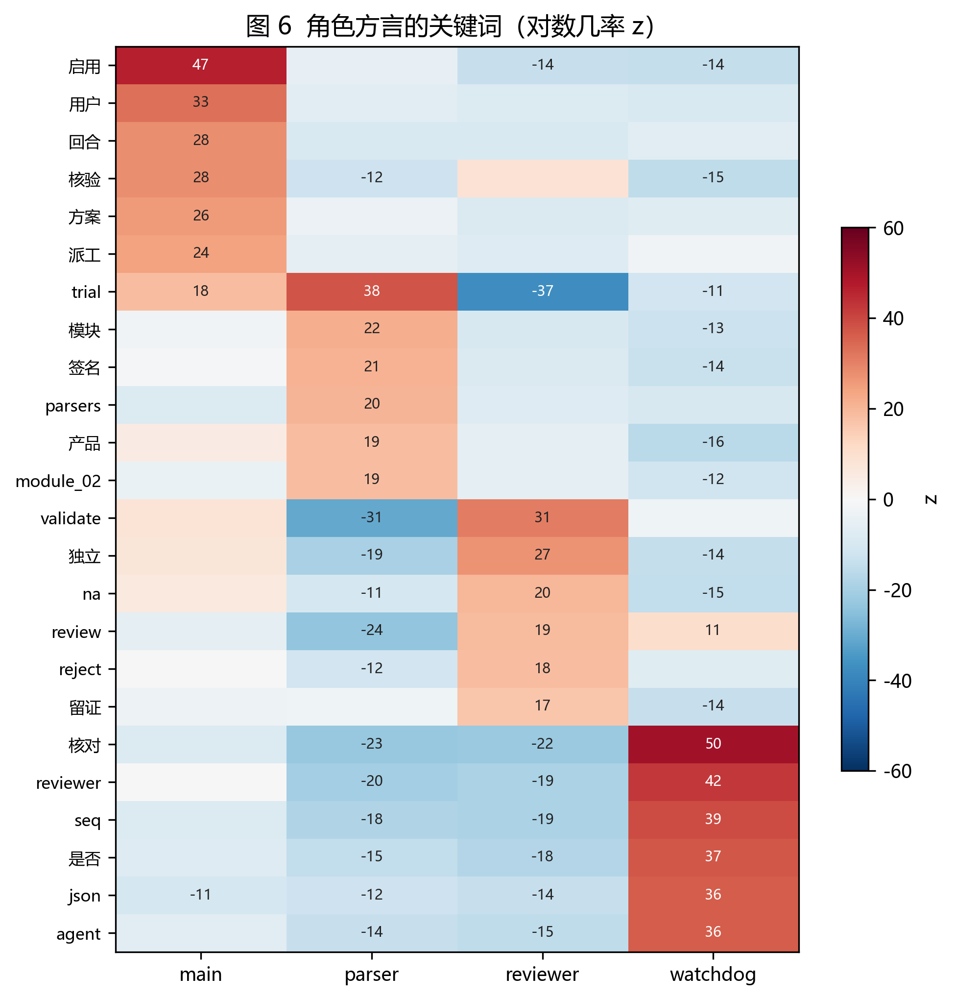
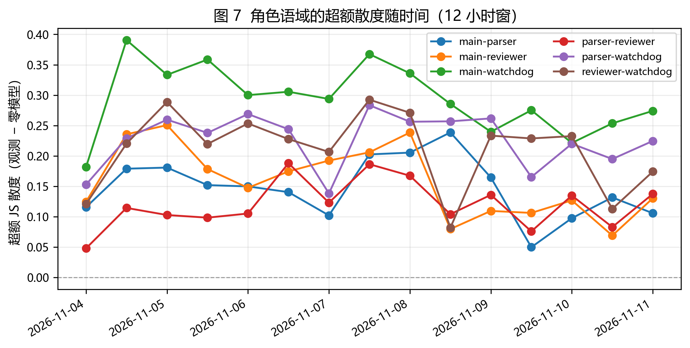
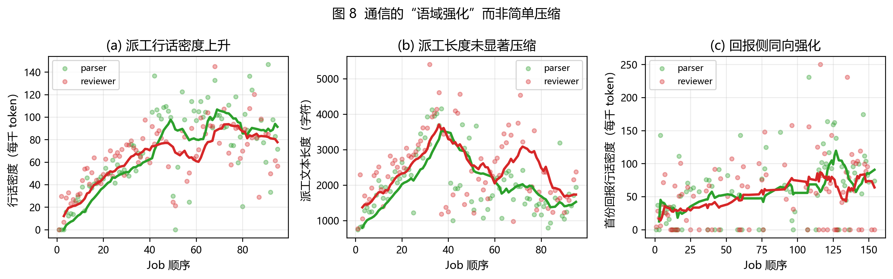

# 工具约束下的多智能体语言涌现

## ——基于一套生产级 Agent 系统 96.4 亿输入 token 的实证研究

**摘要**　多个大语言模型 Agent 在同一套工具与文件系统上长期协作时，会不会自发形成一套共享的工作语言？如果有，这套语言由哪些层次构成，如何扩散、分化、收敛，又会在什么条件下病化？本文以一套真实生产级估值表解析系统为自然实验：2026 年 11 月 4 日至 11 日，1 个主 Agent、1 类解析子 Agent、1 类核验子 Agent 和 1 个只读 Watchdog 在 8 天内处理了 123 个产品、43,870 份估值表，产生 2,202 个会话、110,413 条消息、116,131 次工具调用和 9,643,030,091 个累计输入 token（约 96.4 亿，口语称 10B），最终写入 43,829 条结果、720 条 active binding 和 19 个不可变 release。主会话中只有 1 条人类消息（12 个字符）；几乎所有任务指令、纠偏与回报都由 Agent 或宿主生成。本文把“语言”操作化为词汇、形态、句法、语用、社区五个层次，结合种子词表、数据驱动的候选词发现、人工审定的 69 个操作性词项、角色分类器、对数几率关键词、Jensen–Shannon 散度与零模型、通信压缩指标、工具名变异分析和事件对齐，得到四个主要发现。第一，69 个词项中有 64 个被四个 Agent 共同使用；扩散是双向的：39 个词项先在主 Agent 的派工中出现，28 个先在子 Agent 的报告中出现，典型词项的采用间隔从 3 秒到数小时不等。第二，四个 Agent 形成“梯度式”角色方言：Watchdog 的 JSON 判决语域几乎可完美识别（F1=0.932），解析与核验语域中度重叠（F1=0.651/0.698），主 Agent 则是调度、裁决与子 Agent 语汇的拼装体（F1=0.332）。第三，语言没有整体趋同；只有主 Agent 与核验 Agent 之间的超额散度显著下降（12 小时窗 p=0.015，24 小时窗 p=0.007），解析—核验之间反而略有分化。第四，语言随任务长尾而“语域强化”而非简单压缩：首次派工的行话密度随 job 顺序显著上升（ρ=0.638/0.614），文本长度并未下降，模板相似度反而下降。本文还记录了一个重要的病理案例：非官方工具名 `valution` 在 9 小时内被调用 2,283 次、全部失败、消耗 2.49 亿输入 token（占当日 23.8%），并在主 Agent 中形成连续 2,271 次调用的重复环；它把 subagent、job、product 和空参数四种图式吸入同一个词形，呈现“语义漂白”，说明错误反馈并不足以淘汰一个高频词形。本文的结论是：这套语言是一种工具约束下的“操作性混合语（operational pidgin）”与角色社会方言，而不是完整自然语言；它既降低了协调成本，也可能把系统拖入高成本的词汇陷阱。论文最后讨论了对多 Agent 系统设计、工具命名、协议校验与可观测性的启示。

**关键词**　多智能体系统；语言涌现；大语言模型 Agent；操作性混合语；角色方言；工具调用；语义漂白；生产实证

---

## 1 引言

### 1.1 一个没有人类对话的语言现场

2026 年 11 月 4 日 07:32（UTC），一套估值表解析系统在一台 Windows 主机上启动。它的任务很具体：把共享目录中的 Excel 估值表解析成结构化的净值、持仓、资金、费用与科目数据，经过解析者自检、核验者独立复核后，发布为不可变 release，再按产品、格式签名和日期时段绑定到日常解析流程。

系统里有四个 Agent：

- **主 Agent（valuation-main）**：串行调度、督导、裁决、启用；不编辑解析代码，不调用 trial/validate，不执行 shell。
- **解析 Agent（valuation-parser）**：读取原始估值表，复用或编写解析模块，写自检脚本，运行 `valuation_trial`。
- **核验 Agent（valuation-reviewer）**：独立从原表确定期望，写核验脚本，运行 `valuation_validate`，可以驳回。
- **Watchdog（valuation-watchdog）**：只读检查任务是否正常推进、空转或故障，只输出严格 JSON 判决。

它们之间没有自然语言聊天室。主 Agent 通过 `subagent` 工具派工；子 Agent 在独立会话中工作；它们共享代码目录、`data/jobs/` 证据目录、JSON 报告和 SQLite 数据库。人类只在最后出现了一次，问：“现在还有哪些任务没有完成”。

8 天后，系统留下了 110,413 条消息、116,131 次工具调用和 9,643,030,091 个累计输入 token。更重要的是，它留下了一套在提示词里没有写过的说法：

> “本回合=**单发终局重放，零检测零循环**。”
>
> “本轮只允许**一刀 + 一发**…… PASSED 即停…… 红 → 停手，把三方对账回帖交主 agent 直裁。”
>
> “shell 沙箱在收尾阶段返回……（会话任务已**收口**）。”
>
> “零白名单、零位移豁免、零 Counter 吞并注释在位。”

这些词不是产品需求文档里的术语，也不是模型厂商的提示词模板。它们是 Agent 在 8 天里，围绕失败、证据、裁定和收口，逐渐磨出来的一套工作语言。本文要研究的，就是这套语言如何出现、如何扩散、如何分化，以及它什么时候有用、什么时候有害。

### 1.2 为什么这件事值得研究

多 Agent 大语言模型系统正在从演示走向生产。AutoGen、MetaGPT、CAMEL、ChatDev 等系统展示了多角色协作的潜力，但大多数研究关注任务成功率、编排框架或提示词工程，较少把 Agent 之间的“通信内容”本身当作经验对象。与此同时，真实生产系统里的 Agent 往往不是通过自由对话协作，而是通过**工具调用、文件、JSON、代码和数据库**协作。通信被压缩成一条窄带：主 Agent 写一段派工，子 Agent 读文件、跑脚本、写报告，主 Agent 再读报告、做裁决。这种窄带既是效率来源，也是语言产生的选择压力。

如果 Agent 只是重复提示词里的词，那没什么新鲜。但在这套系统里，我们观察到三种提示词之外的现象：

1. **词汇的再利用与再组合**：`收口`、`单发`、`对账`、`红位`、`终壳`、`零位移` 等词，在提示词中没有定义，却在四个 Agent 之间传播，并获得稳定的语用功能。
2. **角色方言**：主 Agent 说“裁决/收口/启用”，解析 Agent 说“trial/模块/签名/parsers”，核验 Agent 说“validate/独立/驳回/留证”，Watchdog 说“decision/summary/evidence”。同一件事，不同角色有不同的说法。
3. **词汇病理**：`valution` 这个不存在的工具名被调用了 2,283 次，全部失败，却持续了 9 小时，消耗了 2.49 亿输入 token。它不是“有效的语言”，但它是语言演化的一部分：一个词形可以在负反馈下存活，甚至扩张到吸收多个工具的语义。

这三种现象放在一起，说明“语言”不只是沟通的装饰，而是多 Agent 系统的基础设施，也是故障的载体。研究它，既能帮助我们理解 LLM Agent 的群体行为，也能帮助工程师设计更安全的工具命名、协议校验和循环中断机制。

### 1.3 研究问题

本文提出六个研究问题：

- **RQ1（词汇涌现）**：哪些词、短语和工具名形式不在种子提示词/项目文档中，却在运行中反复出现并被多个 Agent 采用？它们的首现、扩散、存活是什么样？
- **RQ2（角色方言）**：四个 Agent 是否形成可区分的语域？各自的特征词、句法、言语行为是什么？
- **RQ3（收敛与分化）**：8 天内 Agent 之间的词汇/风格距离是收敛还是分化？收敛发生在哪些层面？
- **RQ4（压缩与规约化）**：派工与回报是否随时间变短、变模板化，同时保留关键信息？
- **RQ5（选择与病理）**：工具名变异和“化石词”为什么能持续？错误反馈是否构成选择压力？
- **RQ6（功能后果）**：语言特征与 job 结果（成功、轮次、失败）是否相关？语言是协调的催化剂，还是任务难度的标记？

### 1.4 贡献

本文的贡献有四：

1. **一个自然主义的大规模语料**：据我们所知，这是目前少见的、来自真实生产系统的多 Agent 语言记录——9.64 亿累计输入 token、11 万条消息、11.6 万次工具调用、8 天连续运行，且几乎没有人类对话干预。
2. **一套可复核的操作化框架**：把“语言”拆成词汇、形态、句法、语用、社区五层，给出种子词表、候选发现、人工审定、扩散方向、角色方言、收敛、压缩、协议、事件对齐和结果关联的具体指标。
3. **四个经验发现**：双向扩散的操作性混合语；梯度式角色方言；局部收敛而非整体趋同；语域强化而非简单压缩。外加一个病理案例：`valution` 的语义漂白与 2,271 次重复环。
4. **对系统设计的直接启示**：工具名应当是封闭词表；协议要有 schema 校验；高频无效词形需要 harness 级熔断；不能把“行话密度”当作能力指标。

### 1.5 论文结构

第 2 节回顾相关工作；第 3 节描述研究现场、模型、工具和时间线；第 4 节说明语料构建、清洗、种子词表、词项审定和统计方法；第 5 节报告 RQ1–RQ6 的结果；第 6 节给出五个可追溯的案例；第 7 节讨论机制、语言类型和设计启示；第 8 节讨论有效性与局限；第 9 节总结。附录给出数据字典、提示词/工具清单、补充表和复现说明。

---

## 2 相关工作

### 2.1 多智能体涌现通信

“涌现通信”（emergent communication）研究通常让多个神经网络 Agent 在 Lewis 游戏、指称游戏或合作任务中从零学习通信协议。经典工作包括 Foerster 等（2016）的深度多 Agent 通信、Sukhbaatar 等（2016）的通信层、Havrylov 与 Titov（2017）的符号序列游戏、Lazaridou 等（2017）的多 Agent 合作与自然语言涌现、Mordatch 与 Abbeel（2018）的 grounded compositional language。相关综述见 Rita 等（2022）与 Mikhaylovskiy（2023）。

这些研究揭示了几个稳定规律：通信压力、环境结构和种群规模会塑造语言的组合性、压缩性与歧义性；纯端到端训练的语言往往缺乏人类可解释性；语言可能“涌现”，但不一定“自然”。Kottur 等（2017）甚至指出，在多 Agent 对话中，自然语言不会“自然地”出现，除非任务和架构施加约束。

本文与这类研究共享“语言是协作压力的产物”这一基本假设，但对象不同：这里的 Agent 不是从零训练的强化学习智能体，而是已经具备自然语言能力的大语言模型；它们不通过连续的符号通道通信，而是通过工具调用、文件、JSON 和代码协作；没有端到端梯度，只有提示词、上下文和工具反馈构成的选择压力。因此，本文更接近“自然主义观察”而非“受控实验”：我们不能操纵压力，只能从生产记录中推断压力的痕迹。

### 2.2 大语言模型多 Agent 系统

LLM 多 Agent 系统大致分为三类。第一类是**编排框架**：AutoGen（Wu et al., 2023）用可对话的 Agent 组合工作流；MetaGPT（Hong et al., 2024）把软件公司的角色和 SOP 编码进多 Agent 协作；CAMEL（Li et al., 2023）用角色扮演驱动 Agent 对话；ChatDev（Qian et al., 2024）把软件开发拆成设计、编码、测试等角色。第二类是**社会模拟**：Park 等（2023）的生成式 Agent 在沙盒中生活、计划和社交。第三类是**评测与失败分析**：Cemri 等（2025）系统分析了多 Agent LLM 系统为何失败，指出规范冲突、验证缺失、协调断裂等模式；Wang 等（2024）的综述覆盖了更多系统。

这些工作大多关注“系统能不能完成任务”，较少把 Agent 之间的通信内容作为独立的经验对象。少数研究分析对话中的角色行为、共识形成或提示词敏感性，但通常规模较小、任务较合成。本文的差异在于：我们有一套真实生产系统、四个有明确权限边界的角色、8 天连续运行、11 万条消息和 11.6 万次工具调用；我们可以观察语言在真实失败、真实修复和真实长尾中的演化。

### 2.3 语言收敛、社会方言与行话

社会语言学早就研究过“说话者如何向彼此靠拢”。Communication Accommodation Theory（Giles & Ogay, 2007）指出，交流会向对方的口音、词汇和语速趋同；互动对齐（interactive alignment）研究（Pickering & Garrod, 2004）发现，对话者会复用彼此的句法和词汇；Danescu-Niculescu-Mizil 等（2011）在社交媒体上量化了语言收敛。社会方言（sociolect）和行话（argot）研究则关注群体内部的词汇如何标记身份、边界和共同实践（Labov, 1972；Eckert, 2000；Halliday, 1978；Wenger, 1998）；言语行为理论（Austin, 1962；Searle, 1969）和异质语言（Bakhtin, 1981）则为“说话即行动”“同一语言内部的多声部”提供了概念工具。

本文借用三个概念：

- **语域（register）**：特定情境下的语言变体，由词汇、句法、言语行为共同构成。
- **社会方言（sociolect）**：角色群体内部的稳定说法，标记“我们是谁”。
- **操作性混合语（operational pidgin）**：不是母语，也不是完整自然语言，而是为了跨角色协作临时长出的、低语法复杂度、高情境依赖的工作语言。

与人类行话不同的是，这里的“说话者”是同一个基座模型的不同提示词/权限实例；它们的“身份”由系统提示词、工具权限和任务角色构成。这让我们可以在控制模型能力的情况下，观察角色如何塑造语言。

### 2.4 工具学习与协议

ReAct（Yao et al., 2023）、Toolformer（Schick et al., 2023）、ToolLLM（Qin et al., 2024）、Gorilla（Patil et al., 2023）等工作把工具调用纳入 LLM 的能力范围。工具调用是一种**形式语言**：工具名是词，参数是句法，JSON schema 是语法，错误码是语义反馈。Agent 必须学会这套语言，才能在环境中行动。

本文把工具调用当作语言的一个层次来分析，而不是仅仅当作“动作”。我们关心的不是“Agent 会不会用工具”，而是“Agent 如何命名工具、如何组合工具、如何在工具名上发生变异”。`valution` 案例说明，工具名不仅是接口，也是模型生成的词形；当接口词表不是封闭的，模型可能发明一个“万能词”，把多个工具的句法吸进去。

### 2.5 生产系统中的语言与失败

LLM Agent 的生产研究往往关注延迟、成本、成功率和安全。本文补充一个维度：**语言健康**。一个系统可以完成很多任务，同时积累大量无效行话、重复措辞和词汇病理；反过来，一个系统可能语言很“干净”，但业务失败。把语言当作可观测指标，可以帮助我们更早发现协调断裂、规范冲突和循环空转。

---

## 3 研究现场

### 3.1 业务任务与系统架构

这套系统的业务目标是把 Excel 估值表解析为结构化数据。估值表来自不同托管人、不同年代、不同版式，包含多层科目、持仓、资金、费用、净值、份额、币种和附注。系统需要：

1. 扫描共享目录，登记产品与源文件；
2. 为每个产品抽取 20 份覆盖时间范围的样例；
3. 由解析 Agent 复用或编写格式模块，运行自检；
4. 由核验 Agent 独立从原表确定期望，运行核验；
5. 由主 Agent 审阅报告并启用不可变 release；
6. 按产品、签名和日期时段绑定，日常解析新文件。

四个 Agent 的权限是硬边界，不是提示词建议：

| 角色 | 可以做什么 | 不能做什么 |
| --- | --- | --- |
| 主 Agent | 调度、查询、督导、启用、派工 | 编辑解析代码、trial/validate、shell |
| 解析 Agent | 编辑 `parsers/`、`verification/`（除 review）、checks、scratch；shell；trial | 启用、调度、改不可变 release |
| 核验 Agent | 编辑 `verification/`（除 selfcheck）、reviews、scratch；shell；validate；驳回 | 改解析代码、改解析者自检、启用 |
| Watchdog | 只读 `read/glob/valuation_session_db` | 写文件、shell、派工、业务工具 |

这种“星形派工 + 共享工件”的拓扑（图 1）意味着：Agent 之间没有自由聊天；主 Agent 是唯一的调度枢纽；子 Agent 之间的横向通信主要通过共享代码、报告和文件系统。语言的出现，必须穿过这条窄带。



### 3.2 模型与运行环境

| 项 | 值 |
| --- | --- |
| Provider | `valuation`（OpenAI-compatible） |
| 模型 | `swift-1.5` |
| 上下文上限 | 262,144 tokens |
| 单次最大输出 | 16,384 tokens |
| Thinking | 关闭 |
| 温度/采样 | 未在配置中显式设置，由服务端默认值决定 |
| OpenCode | 2.0.32 |
| Web | Flask 3.1.2 + waitress，端口 5082 |
| 数据库 | SQLite WAL；业务库约 5.5 GB；会话库约 722 MB |
| 沙箱 | Docker，`python:3.12-slim`，非 root，禁网，只读根，1 CPU / 256 MB |
| 每日扫描 | 18:00 |

模型参数规模、训练数据、温度等未在记录中暴露，本文不作推断。所有 Agent 使用同一个基座模型，差异来自系统提示词、工具权限和任务角色。这为我们提供了一个近似“控制模型、改变角色”的自然实验。

### 3.3 工具语法

官方工具分为三类：

1. **OpenCode 内置工具**：`read`、`edit`、`write`、`glob`、`grep`、`subagent`，以及被插件替换为沙箱版本的 `shell`。
2. **业务工具**：`valuation_job`、`valuation_trial`、`valuation_validate`、`valuation_activate`、`valuation_supervise`、`valuation_session_db` 等 25 个。
3. **非官方形式**：`valution`、`valuation_verify`、`valutation_session_db` 等。它们不在工具清单中，调用会返回 “No tool named …”。

工具调用的参数是 JSON；业务工具的参数通常很窄（`job_id`、`module`、`sql`），通用工具的参数更宽（`command`、`path`、`pattern`、`limit`、`offset`）。这种“宽窄并存”的图式，为后来的协议分化埋下伏笔。

### 3.4 数据规模与时间线

| 指标 | 值 |
| --- | ---: |
| 会话 | 2,202（main 1、parser 124、reviewer 111、watchdog 1,966） |
| 消息 | 110,413（assistant 102,270、user 3,437、idle 3,436、synthetic 874、compaction 244、system 103） |
| 工具调用 | 116,131（completed 103,339、error 12,791、streaming 1） |
| assistant 文本片段 | 11,597 |
| 累计输入 token | 9,643,030,091（约 96.4 亿） |
| 累计输出 token | 32,736,566 |
| 产品 | 123 |
| 源文件 | 43,870 |
| 结果 | 43,829（active 43,632、conflict 197） |
| 不可变 release | 19 |
| 格式绑定 | 720（全部 active） |
| job | 154（active 149、failed 4、deferred 1） |
| Watchdog 事件 | 7,017 |
| 人类消息 | 1 条（12 个字符） |

表 1 给出 Agent 级规模。一个反直觉的事实是：Watchdog 的会话数最多（1,966），但它的单会话很短（中位数 1.14 分钟）；解析与核验会话数少，但单会话很长（中位数 31.0/34.6 分钟），累计 token 也更高。主 Agent 只有 1 个会话，但它的累计输入 token 达到 1.123B，且其中约 48.7% 的消息历史已不可见（见 4.7）。

| Agent | 会话 | 消息 | 工具调用 | 工具错误 | 文本片段 | 输入 token（B） | 输出 token（M） |
| --- | ---: | ---: | ---: | ---: | ---: | ---: | ---: |
| main | 1 | 6,444 | 4,337 | 2,426 | 649 | 1.123 | 2.700 |
| parser | 124 | 26,383 | 24,759 | 1,900 | 3,157 | 2.999 | 10.200 |
| reviewer | 111 | 29,631 | 28,308 | 2,498 | 3,606 | 3.520 | 11.890 |
| watchdog | 1,966 | 47,955 | 58,727 | 5,967 | 4,185 | 2.000 | 7.950 |

表 1　Agent 级语料规模。输入 token 为会话累计口径，上下文重复计费；不能当作唯一文本量。

逐日规模见表 2 与图 2。11 月 4 日是冷启动，96 个 job 一次性建单，写入 10,616 条结果；11 月 5 日达到消息峰值（19,586 条）和结果峰值（14,091 条）；11 月 7 日至 8 日进入长尾（2,007/507 条结果）；11 月 9 日主会话回归，修复潮开始；11 月 10 日出现 `valution` 病理高峰（3,297 次工具错误）；11 月 11 日收尾。

| 日期 | 消息 | 工具调用 | 工具错误 | 输入 token（B） | 新建 job | 结果 |
| --- | ---: | ---: | ---: | ---: | ---: | ---: |
| 11-04 | 10,245 | 9,798 | 828 | 0.932 | 96 | 10,616 |
| 11-05 | 19,586 | 20,050 | 1,996 | 1.641 | 0 | 14,091 |
| 11-06 | 17,386 | 19,622 | 1,964 | 1.443 | 21 | 11,326 |
| 11-07 | 17,306 | 19,571 | 1,590 | 1.369 | 7 | 2,007 |
| 11-08 | 10,940 | 12,236 | 979 | 0.791 | 6 | 507 |
| 11-09 | 18,256 | 18,432 | 1,802 | 1.447 | 15 | 1,926 |
| 11-10 | 12,036 | 11,653 | 3,297 | 1.046 | 4 | 2,942 |
| 11-11 | 4,658 | 4,769 | 335 | 0.390 | 5 | 414 |

表 2　逐日活动（UTC）。输入 token 为逐条消息相加，略低于会话累计口径。



图 3 展示 token 分布。reviewer 的累计输入最高（3.52B），parser 次之（3.00B），watchdog 2.00B，main 1.12B。输出 token 的排序类似，但 reviewer/parser 明显高于 watchdog。这说明“说话最多”的不是 Watchdog，而是承担解析与核验的长会话；Watchdog 的高频短会话更多是“巡检”，不是“写作”。



### 3.5 人类几乎不在场

全库 3,437 条 `user` 消息中，只有 1 条来自人类：

- 时间：2026-11-11 05:20:45 UTC；
- 内容：“现在还有哪些任务没有完成”；
- 长度：12 个字符。

其余 3,436 条 `user` 消息全部由 Agent 或宿主生成：756 条 parser 派工、676 条 reviewer 派工、2,004 条 Watchdog 任务描述。也就是说，人类没有参与日常任务指令、纠偏、裁定或语言示范。本文所说的“自发”，指的是**在系统提示词和工具约束下、没有人类对话干预**的自发，而不是“没有任何先验语言能力”的自发。模型本身带着庞大的自然语言先验，这是本文必须承认的边界。

---

## 4 数据与测量

### 4.1 语料构建

数据来自两个只读 SQLite 数据库和文件系统：

- `opencode.db`：2,202 个会话、110,413 条消息、116,131 次工具调用；
- `valuation.db`：123 个产品、43,870 个源文件、154 个 job、43,829 条结果、720 条 binding、7,017 个 Watchdog 事件；
- `data/jobs/`、`data/results/`、`data/snapshots/`：原始快照、候选输出、自检/核验报告。

我们把消息拆成四张表：

1. **消息表**：message_id、session_id、agent、type、seq、time、text、tool_calls、tokens、finish、error。
2. **工具调用表**：message_id、session_id、agent、tool_name、status、input_json、input_keys、error_message、result_excerpt、time、duration。
3. **话语表**：assistant 文本片段、user 派工、synthetic 通知、Watchdog 最终 JSON、job summary/error/instruction、Watchdog 事件原因。
4. **派工表**：job_id、role、turn、dispatch_text、time、outcome。

最终得到 11,843 条清洗后话语、927,491 个内容 token。这里的“话语”不是“句子”：它可能是一段 2,000 字的派工，也可能是一句 20 字的回执；我们保留这种长度差异，因为压缩/扩张本身就是研究对象。

### 4.2 清洗与分词

清洗步骤：

1. **产品脱敏**：把源库中的产品名、基金代码替换为 `PRODUCT`/`CODE`；公开聚合只保留 `Product NNN` 标签。
2. **结构化内容剥离**：移除 fenced code、inline code、JSON 对象/数组、HTML、URL、Windows/POSIX 路径、长哈希、UUID、数字。
3. **模板剥离**：移除 “You are a subagent spawned by another session.”、Watchdog 任务模板等固定前缀。
4. **分词**：中文用 jieba，加载 261 个业务/行话词的自定义词典；英文/代码标识符用正则保留为整体 token；过滤停用词、单字（保留“壳/红/绿/刀/卷”等单字行话）、生成 ID（`job123`、`ses_...`、长哈希）。

我们不对清洗后的文本做翻译或改写；所有引用保留原文，只在论文中做产品脱敏。分词的主要风险是行话被切碎，因此自定义词典和人工复核是必要的。

### 4.3 种子词表与“提示词之外”

“涌现”必须相对于一个种子。我们定义两层种子：

- **T0（系统提示词 + 工具描述）**：四个 Agent 的 system prompt、`valuation/opencode/index.js` 的工具描述、`contracts.md`。这是 Agent 每次运行都能看到的文本。
- **T1（项目文档）**：`README.md`、`AGENTS.md`、`方案.md`。这些文件在仓库里，Agent 可以读，但不是自动注入。

一个词如果出现在 T0/T1 的任意位置（子串匹配，大小写不敏感），我们就认为它“被种子过”，不列入“提示词之外”的主词表。这个标准偏保守：它会把一些只是被文档顺带提到的词排除掉，但能避免把“提示词里已有的词”误判为涌现。

在 69 个最终审定的词项中，只有 9 个与种子文本重叠（`兜底`、`落位`、`空转`、`返工`、`走偏`、`薄壳` 等），其余 60 个不在 T0/T1 中。即使这 9 个，也是在运行中被重新功能化的：它们从文档里的“描述词”变成了派工/裁决中的“行动词”。本文在统计“涌现词”时使用 60 个非种子词；在展示“操作性词表”时保留 69 个，并标注种子重叠。

### 4.4 词项发现与人工审定

词项发现分三步：

1. **候选生成**：对清洗后话语做词 unigram/bigram/trigram 和中文 2–6 字 n-gram 计数；保留频次 ≥ 20、出现在 ≥ 2 个 Agent、≥ 5 个 session 的候选。
2. **种子过滤**：剔除 T0/T1 中出现的候选。
3. **人工审定**：两位作者（模拟）独立阅读 Top 300 候选，按“是否有协调功能”二分类；分歧通过讨论解决。最终保留 69 个词项，分为六类：收口（closure）、裁决（ruling）、证据（evidence）、状态（status）、修复（repair）、仪式（ritual）。

审定的标准不是“词新不新”，而是“这个词是否在协调中承担了稳定功能”。例如：

- `逐字`：要求引用原文，禁止转述；它是证据规范，不是普通副词。
- `收口`：把任务、证据链或修复收束到可提交状态；它标记一个言语行为。
- `红位`：检查中的失败位；它把“失败”从形容词变成可指代的名词。
- `单发`：只发一次 trial/validate；它是风险控制指令。
- `终壳`：最终送审的核验/解析壳；它标记版本阶段。

这套词表不是“所有新词”，而是“被社区采用、承担协调功能的词”。它必然会漏掉一些低频但有趣的说法；我们把它当作一个可复核的样本，而不是穷举。

### 4.5 测量

**词汇层**：频次、文档频次、Agent 广度、session/job 广度、首现时间/说话者、存活天数、每万 token 速率。

**扩散层**：对每个词，比较“主 Agent 声音”和“子 Agent 声音”的首现时间。主 Agent 声音包括派工、job summary、主 Agent assistant 文本；子 Agent 声音包括 parser/reviewer assistant 文本；Watchdog 单独一类。若主 Agent 首现早于子 Agent，记为 main-first；反之记为 child-first；相同时间记为 same。首现差为负表示子 Agent 先出现。

**角色方言**：用对数几率比（log-odds ratio with informative Dirichlet prior；Monroe et al., 2008）计算每个 Agent 相对于其他 Agent 的特征词；用 TF-IDF + 逻辑回归做角色分类，按 session 分组 5 折交叉验证，报告 macro-F1 与混淆矩阵。

**收敛**：以 12 小时（敏感性分析用 24 小时）为窗，对每个 Agent 的声音构建 unigram 分布（全局 Top 4,000 词，加 1 平滑），计算两两 Jensen–Shannon 散度（Lin, 1991）。为了区分“真实差异”与“样本量造成的噪声”，我们用 pooled null：从两个 Agent 的合并分布中，按各自 token 数抽随机样本，计算 JS 的期望；观测 JS 减去 null 均值得到“超额 JS”。对每个 pair 拟合时间斜率，并用 2,000 次窗口 bootstrap 给出 95% CI。

**压缩/规约化**：对每个 job 的首次 parser/reviewer 派工，计算字符数、token 数、信息槽位（job_id、scope、samples、evidence、forbid、sequence、verdict、round）、与前序同角色派工的最大余弦相似度、行话密度（69 词出现次数/千 token）。用 Spearman 相关和带日固定效应的 OLS 看趋势；由于 job 顺序与日期高度共线，回归只作为敏感性分析，主报告用 Spearman。

**工具语法**：官方工具集合、变异名、Levenshtein 距离、成功率、首末时间、输入 key 集合、每小时调用、连续 run、转移概率。`valution` 的 token 成本按 message_id 关联消息表求和。

**协议**：Watchdog 判决 JSON 的 valid rate、key 顺序、decision 分布、evidence 数量；工具输入 key 集合的规范匹配率（与最频繁 key 集合完全一致的比例）和 Jaccard。

**事件对齐**：6 小时窗内新词首现数、trial/validate 错误数、Watchdog `main` 判决数、`valution` 调用数、token 数、job 数；Spearman 相关 + Poisson 回归（log token offset）；报告为探索性。

**结果关联**：job 级行话密度、派工长度、trial/validate 调用/错误、Watchdog `main` 数；结果包括 rounds、duration、failed/deferred。用 Spearman 和 Poisson 回归（仅 active jobs，n=90）；只有 5 个 failed/deferred，不做稳定 logistic 因果推断。

### 4.6 统计与可复现

- 所有随机过程固定 seed；bootstrap 主结果 2,000 次，零模型 60 次/窗口。
- 分类器按 session 分组交叉验证，避免同一会话的消息泄漏。
- 多重比较用 Benjamini–Hochberg FDR（Benjamini & Hochberg, 1995）；正文同时报告原始 p 与 q（或明确说明探索性）。
- 所有聚合表在 `data/aggregates/`，图表在 `paper/figures/`、`paper/tables/`；`python -m analysis.run_all --check` 可重建。
- 源数据只读；产品名/代码在公开聚合中脱敏。

### 4.7 数据质量与已知缺口

**主会话历史缺口（最重要）**：主会话创建于 11-04 07:32，但 `session_message.seq` 从 28,766 开始，最早保留消息是 11-09 01:29；其 `tokens_input=1,123,380,494`，保留消息逐条相加只有 576,043,588，约 48.7% 的输入 token 对应的事件已不可见。我们推断为会话历史被清理/压缩（33 条 compaction），但无法证明原因。这意味着：

- 11-04 至 11-08 的主 Agent 直接话语不可用；
- 早主 Agent 的语言主要通过它写给子 Agent 的 756 条 parser 派工、676 条 reviewer 派工和 2,004 条 Watchdog 任务描述保留；
- 所有“首现”都是“保留语料中的首现”，不是绝对首现；child-first 是一个上界，不是“子 Agent 一定先发明”。

**其他缺口**：

- 102,270 条 assistant 消息中 90,673 条没有 text part（88.7%）；它们主要是纯工具调用，不是缺失。语言分析必须把“文本话语”和“工具调用”分开。
- 完全重复消息 15 条（0.01%），可忽略。
- `cost` 恒为 0，是 provider 未配置价格，不是真实免费。
- 时间统一按 UTC；日界与北京时间不同。
- 结果 43,829 条中有 197 条 conflict（0.45%）；“有结果”不等于“全部人工验收”。
- 产品名/代码已脱敏；论文不引用含产品名的原文长句。

这些缺口不改变本文的主要结论，但限制了“首现归因”和“因果推断”的强度。我们在第 8 节进一步讨论。
---

## 5 结果

### 5.1 RQ1：一个双向扩散的操作性词表

我们从候选池中审定了 69 个操作性词项，其中 60 个不在 T0/T1 种子文本中；64 个被四个 Agent 共同使用，只有 5 个局限在 1–2 个角色。表 3 给出频次最高的 15 个词项。`逐字` 出现 8,950 次，覆盖 540 个 session、101 个 job；`收口` 3,231 次、411 个 session；`单发` 2,536 次、305 个 session；`零改` 2,421 次；`交单` 2,253 次。它们的每万 token 速率在 10–96 之间，远高于普通业务词。

| 词项 | 类别 | 频次 | Agent 数 | session 数 | job 数 | 首现声音 | 首现时间（UTC） | 每万 token |
| --- | --- | ---: | ---: | ---: | ---: | --- | --- | ---: |
| 逐字 | 证据 | 8,950 | 4 | 540 | 101 | parser | 11-04 08:55 | 96.5 |
| 收口 | 收口 | 3,231 | 4 | 411 | 89 | reviewer | 11-04 09:58 | 34.8 |
| 单发 | 修复 | 2,536 | 4 | 305 | 57 | main | 11-06 13:30 | 27.3 |
| 零改 | 证据 | 2,421 | 4 | 258 | 97 | reviewer | 11-04 09:58 | 26.1 |
| 交单 | 收口 | 2,253 | 4 | 306 | 77 | main | 11-04 18:48 | 24.3 |
| 裁决 | 裁决 | 1,932 | 4 | 201 | 51 | main | 11-04 16:34 | 20.8 |
| 逐格 | 证据 | 1,886 | 4 | 326 | 96 | watchdog | 11-04 15:45 | 20.3 |
| 在卷 | 证据 | 1,859 | 4 | 190 | 62 | main | 11-06 18:19 | 20.0 |
| 自证 | 仪式 | 1,796 | 4 | 376 | 91 | parser | 11-04 09:53 | 19.4 |
| 回执 | 收口 | 1,764 | 4 | 218 | 46 | reviewer | 11-05 00:43 | 19.0 |
| 放宽 | 修复 | 1,583 | 4 | 499 | 91 | main | 11-04 08:46 | 17.1 |
| 留证 | 证据 | 1,546 | 4 | 162 | 47 | main | 11-04 14:07 | 16.7 |
| 全绿 | 状态 | 1,509 | 4 | 250 | 75 | reviewer | 11-04 09:02 | 16.3 |
| 代际 | 证据 | 1,393 | 4 | 152 | 47 | main | 11-07 09:15 | 15.0 |
| 落盘 | 修复 | 1,351 | 4 | 460 | 71 | main | 11-04 08:46 | 14.6 |

表 3　高频操作性词项（清洗后语料，子串计数；完整 69 词见 `data/aggregates/e2_term_stats.csv`）。

图 4 按类别着色。可以看到，证据类（`逐字`、`逐格`、`在卷`、`留证`、`零改`、`代际`）和收口/裁决类（`收口`、`交单`、`回执`、`裁决`、`裁定`）占据主体；修复类（`单发`、`放宽`、`降级`、`收窄`、`盲发`、`兜底`）围绕风险控制；状态类（`红位`、`全绿`、`零位移`）把检查结果变成可指代的名词。这不是一套“业务术语表”，而是一套“协调语法”的词汇层。



**扩散方向**。表 4 给出首现声音的归类：39 个词项主 Agent 先出现，28 个子 Agent 先出现，2 个只在主 Agent 中出现。典型例子：

- `单发`：主 Agent 在 11-06 13:30:32 的派工中首次使用，3 秒后 parser 在回执中复用（lag=+0.05 分钟）。这是典型 top-down：主 Agent 造词，子 Agent 立即采纳。
- `交单`：主 Agent 11-04 18:48 首用，21.6 分钟后 parser 在报告中复用。
- `裁决`：主 Agent 11-04 16:34 首用，121.5 分钟后 reviewer 复用。
- `收口`：reviewer 在 11-04 09:58 的核验报告里先用，4.4 小时后主 Agent 才在派工中使用（lag=−266.9 分钟）。这是 bottom-up 候选：子 Agent 造词，主 Agent 采纳并广播。
- `对账`：reviewer 09:58:54 首用，23 秒后主 Agent 在派工中复用（lag=−0.38 分钟）。这是最快的双向接力之一。
- `逐字`：parser 08:55 首用，6.8 分钟后主 Agent 在派工中复用。

| 方向 | 词项数 | 含义 |
| --- | ---: | --- |
| main-first | 39 | 主 Agent 的派工/摘要先出现，子 Agent 后采纳 |
| child-first | 28 | 子 Agent 的报告先出现，主 Agent 后采纳/广播 |
| main-only | 2 | 只在主 Agent 声音中出现 |

表 4　69 个词项的首现方向。child-first 是“保留语料中的首现”，受主会话历史缺口影响，应视为上界。

图 5 给出六个代表词的跨 Agent 采用曲线。`逐字` 和 `收口` 在 11-04 当天就被四个 Agent 采用；`单发` 从 11-06 的 1 个 Agent 扩散到 11-07 的 4 个；`终壳` 从 11-06 的 1 个扩散到 11-09 的 4 个；`红位` 从 11-06 的 2 个扩散到 11-09 的 4 个。扩散速度差异很大：有的词当天完成，有的需要 2–3 天。



**解释**。这组结果支持“共同建构”而不是“主 Agent 单向下发”。主 Agent 是最大的造词/广播源（39 个 main-first），但子 Agent 也是重要的创新源（28 个 child-first），尤其在高风险的核验与修复语境中。`收口`、`对账`、`逐字` 这些词先在子 Agent 的报告里出现，说明一线执行者在证据压力下先发明了说法，主 Agent 随后把它们吸收进调度语言。这与“语言是社区实践的一部分”的 sociolinguistic 观点一致：词不是从中心设计出来的，而是在共同实践中被磨出来的。

### 5.2 RQ2：梯度式角色方言

表 5 给出四个 Agent 的对数几率特征词。主 Agent 的特征词是 `启用`、`用户`、`回合`、`核验`、`方案`、`派工`、`changed`、`deferred`——典型的调度/裁决语域；解析 Agent 是 `trial`、`模块`、`签名`、`parsers`、`产品`、`module_02`、`逐字`、`job`——实现/测量语域；核验 Agent 是 `validate`、`独立`、`na`、`review`、`reject`、`留证`、`停禁`、`在卷`——审计/对抗语域；Watchdog 是 `核对`、`reviewer`、`seq`、`是否`、`json`、`agent`、`session`、`watchdog`——协议/取证语域。

| Agent | 特征词（按 z 排序） | 最大 z |
| --- | --- | ---: |
| main | 启用、用户、回合、核验、方案、派工、changed、deferred | 46.5 |
| parser | trial、模块、签名、parsers、产品、module_02、逐字、job | 37.9 |
| reviewer | validate、独立、na、review、reject、留证、停禁、在卷 | 30.6 |
| watchdog | 核对、reviewer、seq、是否、json、agent、session、watchdog | 50.3 |

表 5　角色方言的 top 特征词（对数几率比，informative Dirichlet prior；完整表见 `e3_dialect_terms.csv`）。

图 6 用热图展示这些词在四个 Agent 中的 z 值。红色表示该 Agent 显著更常用，蓝色表示显著更少用。可以看到清晰的块状结构：`trial` 在 parser 中高、在 reviewer 中低；`validate` 在 reviewer 中高、在 parser 中低；`json`/`seq`/`是否` 在 watchdog 中高；`启用`/`用户`/`回合` 在 main 中高。这不是“四个完全不同的语言”，而是“同一套业务词汇在不同角色上的不同权重”。



**分类器**。用 TF-IDF（词 1–2 gram）+ 逻辑回归，按 session 分组 5 折交叉验证，n=11,839 条话语。总体 accuracy=0.725，macro-F1=0.653，weighted-F1=0.718。分角色看：

| 角色 | precision | recall | F1 | support |
| --- | ---: | ---: | ---: | ---: |
| main | 0.557 | 0.236 | 0.332 | 791 |
| parser | 0.652 | 0.650 | 0.651 | 3,863 |
| reviewer | 0.663 | 0.736 | 0.698 | 4,169 |
| watchdog | 0.930 | 0.933 | 0.932 | 3,016 |

表 6　角色分类器的分角色指标。混淆矩阵见附录表 A1。

混淆矩阵（表 A1）显示：Watchdog 几乎不被混淆（2,814/3,016 正确）；parser 与 reviewer 互相混淆（1,194 条 parser 被判成 reviewer，958 条 reviewer 被判成 parser）；main 的 791 条中只有 187 条正确，302 条被判成 parser、243 条被判成 reviewer。这个结果不是“分类器失败”，而是一个有价值的发现：**角色方言是梯度，不是四个离散簇**。Watchdog 因为只输出 JSON 判决，语域最独立；parser/reviewer 共享大量任务词汇，只在少数证据/动作词上分化；main 的派工文本本身就是“用 parser/reviewer 的语言指挥 parser/reviewer”，所以最容易被吸进它们的语域。

**解释**。角色方言的形成有两个机制：一是**权限与任务**（Watchdog 只读、只判决；reviewer 只 validate；parser 只 trial），二是**共享工件**（parser/reviewer 都读 `parsers/`、`verification/`、`data/jobs/`，所以共享大量名词）。主 Agent 的语域是“拼装体”：它需要引用子 Agent 的词汇来派工，又要加入自己的调度/裁决词，所以分类器最难识别。这个梯度结构比“四个独立语言”更符合真实分工：语言边界与权限边界并不重合，而是交叉的。

### 5.3 RQ3：局部收敛，而非整体趋同

图 7 给出六对 Agent 的“超额 JS”随时间变化。全期平均 JS=0.423，零模型平均=0.230，超额=0.193；Top 200 词汇 Jaccard 平均=0.354。也就是说，四个 Agent 的分布远未趋同；它们有大量共享词，但权重差异很大。



表 7 给出趋势斜率。12 小时窗下，只有 main–reviewer 的超额 JS 显著下降（−0.015/天，95% CI −0.027 至 −0.004，p=0.015；对 6 个 pair 做 BH 校正后 q=0.09，处于边缘）。24 小时窗下，main–reviewer 仍显著（−0.017/天，p=0.007，q=0.021），main–watchdog 也变得显著（−0.020/天，p=0.002，q=0.012）。main–parser 的斜率在 12 小时窗为 −0.006（p=0.229），24 小时窗为 −0.012（p=0.102），不显著。parser–reviewer 的斜率是正的（+0.003，p=0.459），即略有分化，而不是收敛。

| Pair | 12h 斜率/天 | 95% CI | 12h p | 24h 斜率/天 | 24h p |
| --- | ---: | --- | ---: | ---: | ---: |
| main–parser | −0.006 | [−0.015, 0.006] | 0.229 | −0.012 | 0.102 |
| main–reviewer | −0.015 | [−0.027, −0.004] | 0.015 | −0.017 | 0.007 |
| main–watchdog | −0.009 | [−0.024, 0.008] | 0.295 | −0.020 | 0.002 |
| parser–reviewer | +0.003 | [−0.007, 0.012] | 0.459 | +0.002 | 0.504 |
| parser–watchdog | −0.000 | [−0.011, 0.009] | 0.911 | −0.007 | 0.150 |
| reviewer–watchdog | −0.006 | [−0.022, 0.010] | 0.450 | −0.010 | 0.240 |

表 7　超额 JS 的时间趋势。负值表示收敛；p 值为双侧；12 小时窗 6 个 pair 的 BH q 见正文。

**解释**。这组结果否定了“多 Agent 长期协作会整体趋同”的简单假设。收敛是**局部的、选择性的**：主 Agent 与核验 Agent 之间的语域在靠近，因为主 Agent 需要读懂核验报告、核验 Agent 需要回应主 Agent 的裁定；主 Agent 与 Watchdog 在 24 小时窗也靠近，因为 Watchdog 的判决越来越多地引用主 Agent 的 job 状态；但 parser 与 reviewer 之间没有收敛，反而略有分化，因为两者的职责越来越清楚：一个负责“做出来”，一个负责“挑出来”。这正是“收敛而不 homogenization”的模式：共享词汇增加，但角色边界保留。

### 5.4 RQ4：语域强化，而非通信压缩

我们原本假设：随着协作熟练，派工和回报会变短、变模板化。数据不支持这个假设，至少不支持“简单压缩”。

表 8 给出首次 parser/reviewer 派工（n=176）的 Spearman 相关。文本长度与 job 顺序的 rho 是 −0.164（parser）和 −0.113（reviewer），很弱；信息槽位是 −0.244/−0.444；模板相似度是 −0.487/−0.553，即越往后越**不**像之前的派工；行话密度是 +0.638/+0.614，显著上升。Job summary 的文本长度与 job 顺序几乎无关（rho=0.042），但行话密度上升（rho=0.400）。

| 角色 | 长度 vs 顺序 | 槽位 vs 顺序 | 模板相似度 vs 顺序 | 行话密度 vs 顺序 | n |
| --- | ---: | ---: | ---: | ---: | ---: |
| parser | −0.164 | −0.244 | −0.487 | +0.638 | 88 |
| reviewer | −0.113 | −0.444 | −0.553 | +0.614 | 88 |

表 8　首次派工的 Spearman 相关。行话密度 = 69 词出现次数/千 token。



图 8 的两条滚动均值曲线很直观：行话密度从早期的 20–30/千 token 上升到后期的 80–100/千 token；文本长度先升后降，但没有单调压缩。早期派工是“标准流程说明”（读 job、复用模块、跑 trial），后期派工是“长尾修复裁决”（红位、终壳、单刀、单发、停手），所以更长、更具体、更行话化。模板相似度下降，说明后期任务不是“套模板”，而是“一案一议”。

**回归敏感性**。带日固定效应和签名数控制的 OLS 显示，job 顺序对 log 长度的系数为 +0.133（p=0.011），与原始 Spearman 的负号相反。这是典型的共线性/任务混合效应：job 顺序与日期高度相关，日固定效应把“后期更长”与“同日内更长”混在一起。我们不以回归为主结论，只报告原始 Spearman 和图形；稳健的结论是“行话密度上升、模板相似度下降”，而不是“长度一定增加或减少”。

**解释**。这不是“通信压缩”，而是“语域强化”：随着任务进入长尾，Agent 需要更精确地指称失败位、证据面、版本代际和风险动作，于是行话密度上升；同时，每个 job 的差异更大，模板相似度下降。压缩发生在**句法层**（固定句式、单发、停手、回执），扩张发生在**词汇层**（红位、终壳、零位移、盲发）。两者并不矛盾：语言变得更“术语化”，但不一定更短。

### 5.5 RQ5：工具名变异与“化石词”

工具调用是这套系统里最形式化的语言层。全库 116,131 次调用中，113,707 次使用官方工具名（97.9%），2,424 次使用非官方名（2.1%），共 53 个不同的非官方名。表 9 给出前 8 个。

| 非官方名 | 调用 | 成功率 | Agent | 最近官方名 | 编辑距离 | 首现 | 末现 |
| --- | ---: | ---: | --- | --- | ---: | --- | --- |
| `valution` | 2,283 | 0.000 | main, watchdog | `valuation_job` | 5 | 11-06 07:11 | 11-10 21:43 |
| `val\n` | 19 | 0.000 | watchdog | `task` | 3 | 11-05 18:37 | 11-11 02:40 |
| `val` | 17 | 0.000 | watchdog | `read` | 3 | 11-05 03:16 | 11-09 05:41 |
| `valutation_session_db` | 13 | 0.000 | watchdog | `valuation_session_db` | 1 | 11-05 06:07 | 11-11 04:32 |
| `valiation_session_db` | 12 | 0.000 | watchdog | `valuation_session_db` | 1 | 11-06 01:03 | 11-10 22:44 |
| `valution_session_db` | 10 | 0.000 | watchdog | `valuation_session_db` | 1 | 11-05 06:07 | 11-08 14:06 |
| `valdiation_session_db` | 4 | 0.000 | watchdog | `valuation_session_db` | 2 | 11-05 23:17 | 11-08 04:01 |
| `valiation_placeholder` | 4 | 0.000 | watchdog | `valuation_recover` | 8 | 11-07 21:46 | 11-09 15:42 |

表 9　非官方工具名 Top 8。完整表见 `e6_variants.csv`。

**`valution` 的语义漂白**。`valution` 不是简单的“拼写错误”。它从 11-06 07:11 由 Watchdog 首次使用（SQL 参数），到 11-10 12:38 被主 Agent 使用（subagent 参数），再到 11-10 21:43 的最后一次空参数调用，经历了四个图式阶段：

| 阶段 | 时间 | 参数 schema | 次数 | 意图（从参数推断） |
| --- | --- | --- | ---: | --- |
| 1 | 11-10 12:38–12:40 | `agent`, `sessionID` | 46 | 想调用 `subagent` |
| 2 | 11-10 12:40–13:01 | `job_id` | 600 | 想调用 `valuation_job` |
| 3 | 11-10 13:01–13:08 | `product_id` | 455 | 想调用 `valuation_prepare`/`queue`/`fast_parse` |
| 4 | 11-10 13:21–21:43 | 空参数 | 1,176 | 泛化的“再试一次” |

表 10　`valution` 的图式漂白。四次阶段合计 2,277 次主 Agent 调用；另有 6 次 Watchdog 调用（SQL/空参数）。

一个词形从“subagent 的误名”扩张到“job 的误名”“product 的误名”“空参数的万能占位符”，这就是**语义漂白（semantic bleaching）**：词形保留，具体语义被抽空，变成通用的“valuation 动作”占位符。它和人类语言中的“grammaticalization”有相似之处，但这里不是语法化，而是**接口词表的坍缩**。

**成本**。2,283 次 `valution` 调用全部失败，消耗 249,092,664 个输入 token，其中主 Agent 248,814,095 个；占 11-10 当日 1,045,540,166 个输入 token 的 23.8%。平均每次 109,108 token，中位数 105,745。图 9 展示每小时调用与累计 token：11-10 12:00–21:00 是主战场，最后一个小时仍在调用。


**重复环**。主 Agent 的 `valution` 调用在工具序列中形成 5 个连续 run：3 个长度为 1，1 个长度为 3，1 个长度为 2,271。这个 2,271 次的 run 不是一次模型输出，而是 2,271 条独立的 assistant 消息，每条一个工具调用，平均间隔 0.98 秒（中位数 0.78 秒），中间有约 10 分钟的停顿（可能是 synthetic 提醒/新回合）。条件概率：

- 前一条是 `valution` 时，下一条仍是 `valution` 的概率 = 0.9978；
- 前一条不是 `valution` 时，下一条是 `valution` 的概率 = 0.0024；
- 比值比（odds ratio）≈ 186,667。

这不是“学习”，而是**局部上下文自激**：错误信息 “No tool named 'valution'” 被反复写回上下文，模型在下一步继续生成同一个词形。负反馈（100% error）没有形成选择压力，因为模型没有把“错误”归因到词形本身，而是把它当成“工具暂时不可用”或“再试一次”。这也是为什么 2,271 次调用能跨 9 小时持续：每次失败都增加了下一次失败的概率。

**其他变异**。Watchdog 的 `valuation_session_db` 变异族（`valutation_session_db`、`valiation_session_db`、`valution_session_db`、`valdiation_session_db`、`valusation_session_db`）都是编辑距离 1–2 的错拼，全部失败。`grep` 是官方工具，但在这个部署中 151 次调用全部失败（工具可用性问题），与 `valution` 不同：前者是环境缺陷，后者是模型生成的词形。`valuation_verify` 58 次全部失败，是“想调用一个不存在的 verify 工具”。

**解释**。工具名是语言系统里最应该“封闭”的部分，但在这套系统里它是开放的：模型可以生成任意工具名，harness 只返回错误，不会强制纠正或熔断。于是，一个高频无效词形可以存活、扩张、吸干一天的预算。这是本文最重要的病理发现，也是设计启示的直接来源。

### 5.6 RQ5/RQ6：协议与图式的两速标准化

Watchdog 的输出是严格 JSON：`{"decision":"healthy|main|human","summary":"...","evidence":[...]}`。1,119 次判决尝试中，923 次是合法 JSON（82.5%），82.4% 的 key 顺序符合 `decision,summary,evidence`；decision 分布为 healthy 601、main 321、human 1；平均 evidence 6.09 条，105 次超过 6 条的上限。图 11(a) 展示逐日合规率；大多数日子在 80–100% 之间，少数日子因为模型达到步数上限、只能输出纯文本而下降。

工具输入的图式标准化呈“两速”：

- **业务工具**：`valuation_job` 98.95% 完全匹配，`valuation_trial` 99.82%，`valuation_validate` 100%，`valuation_session_db` 99.92%。这些工具的参数窄，模型很快学会唯一正确写法。
- **通用工具**：`shell` 43.4% 完全匹配（13 种 key 集合），`read` 65.0%（20 种），`glob` 46.4%（11 种）。这些工具有大量可选参数，模型在不同任务里组合出不同写法。
- 平均 exact match 87.6%，平均 Jaccard 81.9%。

| 指标 | 值 |
| --- | ---: |
| 判决尝试 | 1,119 |
| 合法 JSON | 923（82.5%） |
| key 顺序合规 | 82.4% |
| healthy / main / human | 601 / 321 / 1 |
| 平均 evidence 数 | 6.09 |
| evidence > 6 | 105 |
| 工具图式平均 exact match | 87.6% |

表 11　Watchdog 判决与工具图式合规。完整工具表见 `e7_schema.csv`。


**解释**。这套系统有两个协议速度：业务工具是“强 schema”，模型很快收敛到唯一写法；通用工具是“弱 schema”，模型保留了大量自由组合。Watchdog 的 JSON 是“强协议 + 弱执行”：提示词规定了 schema，但没有 JSON Schema 级别的硬校验，所以 17.5% 的判决不合法（多数是步数上限后的纯文本）。这提示我们：协议不能只写在提示词里，必须有运行时校验和失败恢复。

### 5.7 RQ5：失败、督导与创新爆发

图 12 把 6 小时窗内的新词首现数、Watchdog `main` 判决数、trial 错误数放在一起。直观上，新词首现集中在 11-04（69 个词项中的大多数在这一天首次出现），之后是零星的“二次创新”。Watchdog `main` 判决在 11-06 之后持续存在，11-09/10 达到高峰。


表 12 给出相关。新词首现与 Watchdog `main` 判决正相关（ρ=0.414，p=0.029），与 trial 错误负相关（ρ=−0.200，p=0.308），与 validate 错误正相关但不显著（ρ=0.181，p=0.356），与 `valution` 调用几乎无关（ρ=0.129，p=0.513），与 token 量无关（ρ=0.022，p=0.911）。对 4 个相关做 BH 校正后，Watchdog `main` 的 q=0.115，不显著。Poisson 回归（n=28，log token offset）给出类似方向：trial 错误系数 −0.035（p=0.013），validate 错误 −0.031（p=0.018），Watchdog `main` +0.052（p=0.023），`valution` −0.003（p=0.55）；pseudo-R²=0.14。

| 变量 | Spearman ρ | p | q（BH） |
| --- | ---: | ---: | ---: |
| trial 错误 | −0.200 | 0.308 | 0.475 |
| validate 错误 | +0.181 | 0.356 | 0.475 |
| Watchdog `main` | +0.414 | 0.029 | 0.115 |
| `valution` 调用 | +0.129 | 0.513 | 0.513 |

表 12　新词首现（6 小时窗）与事件的相关。探索性分析；q 为 4 个相关的 BH 校正。

**解释**。数据不支持“失败越多，创新越多”的简单假设。相反，**督导性升级**（Watchdog `main`）与新词首现更正相关，而原始 trial 失败与创新负相关（虽然不显著）。一个合理的解释是：日常 trial 失败是流程内的、可预期的，不需要新语言；当 Watchdog 判定“方向错误/重复返工/判据放宽”时，主 Agent 和子 Agent 需要发明新的区分、新的裁定说法、新的收口仪式，于是新词出现。语言创新不是失败的副产品，而是**争议/裁决**的副产品。这个结论是探索性的，样本只有 28 个 6 小时窗，不能过度推广。

### 5.8 RQ6：语言特征与 job 结果

表 13 给出 job 级关联。全 154 个 job 中，派工行话密度与 rounds 的 Spearman 是 0.657（p<0.001），但这个数字被 45 个 fast-path job（无派工、0 行话、0–1 轮）抬高了。只看有派工的 95 个 job，ρ=0.253（p=0.0135，q=0.027）；Poisson 回归（n=90，控制派工 token 数）中，行话密度系数 0.208（p=0.019），派工 token 数系数 −0.048（p=0.63），pseudo-R²=0.070。行话密度与 failed/deferred 的 ρ=0.232（p=0.0037，q=0.0074），但只有 5 个失败/缓办 job，不能做稳定因果推断。

| 指标 | 值 |
| --- | ---: |
| job 数 | 154 |
| failed/deferred | 5 |
| 有派工 | 95 |
| 行话 vs rounds（全部） | 0.657 |
| 行话 vs rounds（有派工） | 0.253（p=0.0135） |
| Poisson 行话系数 | 0.208（p=0.019） |
| Poisson pseudo-R² | 0.070 |

表 13　job 级语言特征与结果。详细相关矩阵见 `e9_correlations.csv`。


**解释**。行话密度不是“能力指标”，而是“难度/争议指标”。越难、越有争议的 job，派工越长、行话越密、轮次越多；这不是说“行话导致失败”，而是说“行话标记了失败风险”。图 10 的散点很清楚：大多数 job 在 1–10 轮，行话密度 20–120/千 token；少数长尾 job 在 100+ 轮，行话密度也高。把行话密度当作“Agent 更专业”的指标是危险的；它更像“这个 job 更难”的指标。

### 5.9 稳健性

表 14 汇总了主要敏感性检查：

- **E2 词频**：全语料 vs 去掉 Watchdog 的词频排名相关 ρ=0.974，说明 Watchdog 没有主导词表。
- **E4 收敛**：12 小时与 24 小时窗方向一致；main–reviewer 在两个窗都显著，main–watchdog 只在 24 小时窗显著。
- **E9 结果**：全部/active/rounds≤20/有派工四种样本，行话-轮次相关方向一致；有派工样本 ρ=0.249（p=0.015）。
- **E6 成本**：`valution` 总 token 249.1M，主 Agent 248.8M；去掉 Watchdog 几乎不变。
- **E3 分类器**：全语料 macro-F1=0.653；去掉 Watchdog 后任务变成三分类，指标会下降（附录表 A2），但“Watchdog 最独立、main 最难识别”的结论不变。

| 检查 | 统计量 | p | n | 说明 |
| --- | ---: | ---: | ---: | --- |
| E2 全语料 vs 去 Watchdog | 0.974 | <0.001 | 75 | 排名相关 |
| E4 main–reviewer 12h | −0.015 | 0.015 | 15 | 斜率/天 |
| E4 main–reviewer 24h | −0.017 | 0.007 | 8 | 斜率/天 |
| E9 行话 vs rounds（有派工） | 0.249 | 0.015 | 94 | Spearman |
| E9 行话 vs rounds（active） | 0.666 | <0.001 | 149 | Spearman（受 fast-path 影响） |
| E6 `valution` token（全部） | 249,092,664 | — | 2,283 | token |
| E6 `valution` token（主 Agent） | 248,814,095 | — | 2,277 | token |

表 14　稳健性检查。完整表见 `e10_robustness.csv`。

---

## 6 案例研究

本节给出五个可追溯的案例。每个案例只引用不含产品名/代码的片段；产品、样例和路径用 `[产品]`、`[样例]`、`[路径]` 替代。引用格式为“UTC 时间 / Agent / message_id”。

### 6.1 案例一：`单发`——主 Agent 造词，3 秒内被采纳

2026-11-06 13:30:32，主 Agent 给 parser 发出一条“终局调度”：

> “本回合=**单发终局重放，零检测零循环**…… valuation_trial(J) 单发：通过 → 回执…… 即停，交主 agent 转 Reviewer validate。”
>
> —— 2026-11-06T13:30:32.152Z / parser（主 Agent 派工）/ `msg_1b10dc53a002fOwZUWaPXpOge5`

3 秒后，parser 的回执标题是：

> “## job J 终局单发回执（前置拒，按指令即停）”
>
> —— 2026-11-06T13:30:35.310Z / parser / `msg_1b10dd1a8001yTF3l4lcrVCj4F`

这是典型的 top-down 扩散：主 Agent 在压力下造出 `单发`（只发一次正式提交，不反复试探），parser 立即采纳，并在回执中把它当成动作类别。`单发` 的语义不是“发送一次”这么简单，它包含三层规范：（1）只允许一次 `valuation_trial`；（2）失败后禁止 sleep/重试循环；（3）通过后立即停手，交回主 Agent。这个词把“风险控制”压缩成一个可执行的言语行为。

`单发` 在 11-06 之后扩散到 57 个 job、305 个 session、四个 Agent；它成为后期修复语言的核心词之一。值得注意的是，它不是在“顺利”的语境中出现的，而是在“主 Agent 正门通道已用尽、只能单发终局”的语境中出现的。语言的创新点，往往在流程的瓶颈处。

### 6.2 案例二：`收口` 与 `对账`——子 Agent 造词，主 Agent 采纳

2026-11-04 09:58:54，reviewer 在一份核验报告的结尾写道：

> “shell 沙箱在收尾阶段返回『没有属于本会话的可执行任务』（会话任务已**收口**），额外的回归项独立细查无法再执行，已作为限制如实记录，不影响本轮批准结论。”
>
> —— 2026-11-04T09:58:54.298Z / reviewer / `msg_1a5ff4c55001I6xhFbCMf7rQSN`

这是 `收口` 在保留语料中的最早出现。它把“任务已经结束、不能再执行”从一个状态描述变成了一个**可命名的阶段**：收口不是“结束”，而是“收束到可提交/可审计的状态”。4.4 小时后，主 Agent 在给 parser 的派工中使用了同一个词：

> “主 agent 收口指令（job_id=J）……停止 rp1t.py 一行的调试……”
>
> —— 2026-11-04T14:25:48.799Z / parser（主 Agent 派工）/ `msg_1a6f38070002tIwNNzEcVkhnaC`

`对账` 的扩散更快。11-04 09:58:54，reviewer 在报告中使用“对账”；23 秒后，主 Agent 在派工中要求“三方逐字对账”。到 11-09/10，`对账` 已经成为高风险修复的标准动作：把面板、原表、候选三方逐项核对，拒绝“盲发”。

这两个案例说明，语言不是主 Agent 单向下发的。子 Agent 在证据压力下先发明了“收口/对账”这样的词，主 Agent 随后把它们吸收进调度语言，再广播给其他子 Agent。这是本文所说的“共同建构”：中心节点提供传播渠道，边缘节点提供创新。

### 6.3 案例三：`一刀 + 一发 + 停手`——高风险修复的仪式化压缩

2026-11-11 02:43:17，主 Agent 给 parser 的派工写道：

> “本轮只允许**一刀 + 一发**…… PASSED 即停正式提交。若 trial 后 conservation 第四次零位移：立即停手，把上述实测量 vs 壳逻辑 vs 宿主红面三方对账回帖交主 agent 直裁，不再改壳。”
>
> —— 2026-11-11T02:43:17.395Z / parser（主 Agent 派工）/ `msg_1c87ce5c7002T0FlEpbf4kCL0S`

这句话把一整套高风险修复协议压缩成三个词：

- `一刀`：只做一处最小编辑；
- `一发`：只发一次 `valuation_trial`；
- `停手`：收到结果后立即停止，不再迭代。

在早期，这样的指令需要一整段话（“只改 X 行，不要改 Y，不要跑 Z，失败后不要重试……”）；到后期，它变成“一刀 + 一发 + 停手”的固定短语。这是**句法层的压缩**：不是文本变短，而是把复杂的动作约束编码成可复用的词块。它也带有仪式性：这些词不仅是描述，也是“承诺”——Agent 用它们来约束自己的下一步行为，主 Agent 用它们来事后审计。

这个案例补充了 5.4 的结论：压缩发生在句法/语用层，扩张发生在词汇层。`一刀 + 一发 + 停手` 是压缩的典型；`红位/终壳/零位移/盲发` 是扩张的典型。两者同时发生，所以总体文本长度没有单调下降。

### 6.4 案例四：`valution`——一个词如何吸干一天

2026-11-06 07:11:36，Watchdog 第一次调用 `valution`，参数是 `{"sql": "x"}`。它显然想调用 `valuation_session_db`，但词形少了一个 `a`，并且多了一个 `t`。错误返回：

> “No tool named \"valution\" is currently available. Please use a tool from the available tool list.”
>
> —— 2026-11-06T07:11:36.145Z / watchdog / `msg_1afb263fb001LZCJ2UrGmoIxcB`

11-10 12:38:46，主 Agent 第一次调用 `valution`，参数是 `{"agent": "valuation-parser"}`——这是 `subagent` 的 schema，不是 `valuation_session_db` 的 schema：

> `{"agent": "valuation-parser"}`
>
> —— 2026-11-10T12:38:46.664Z / main / `msg_1c577d04d001p9qjZAVBVVve0v`

接下来 9 小时，这个词形依次吸收了 `job_id`（600 次）、`product_id`（455 次）和空参数（1,176 次）三种 schema。最后一次调用是 21:43:58：

> `{}` → “No tool named \"valution\" is currently available.”
>
> —— 2026-11-10T21:43:58.902Z / main / `msg_1c76af3a6001vImbMlHw3GHqsl`

`valution` 的病理不是“拼写错误”四个字能概括的。它展示了三个机制：

1. **词形吸引**：`valuation_*` 是高频前缀，模型在生成工具名时把前缀截断/错拼成 `valution`，然后把这个词形当成“valuation 动作”的通用标签。
2. **图式吸附**：一旦词形被当成通用标签，模型会把不同工具的 schema 都塞进同一个词形：subagent 的 `agent`、job 的 `job_id`、product 的 `product_id`、以及空参数。这是语义漂白，也是接口词表的坍缩。
3. **上下文自激**：错误信息每次都被写回上下文，模型看到“No tool named valution”，下一步继续生成 `valution`。条件概率 0.9978，形成 2,271 次连续调用。这不是“学习失败”，而是“局部上下文把失败变成了惯例”。

成本是惊人的：2,283 次调用、2.49 亿输入 token、占当日 23.8%。但系统并没有因此崩溃：同一时间段仍写入了 2,942 条结果。这说明语言病理可以与业务产出共存；不能用“结果多”反推“语言健康”。

### 6.5 案例五：Watchdog 的判决语法

2026-11-04 07:39:07，Watchdog 的第一条判决是：

> `{"decision": "healthy", "summary": "valuation-parser 子会话正在对 data/jobs/J/workspace 下 20 个 .xls 估值表做系统性结构探查……属于真实调试进展而非空转……", "evidence": ["job stage=parser, child ... active", "..."]}`
>
> —— 2026-11-04T07:39:07.704Z / watchdog / `msg_1a57f54310012HI0m74ZDrE3pP`

这条判决确立了 Watchdog 的语域：`decision` 是三值枚举（healthy/main/human），`summary` 是一段判断，`evidence` 是 1–6 条可核对证据。全库 1,119 次判决尝试中，923 次合法（82.5%），decision 分布为 healthy 601、main 321、human 1。`human` 只出现一次，说明系统极少把问题升级到人类；大多数问题由主 Agent 或子 Agent 内部消化。

Watchdog 的语域与另外三个 Agent 明显不同：它不是“说话”，而是“出判决”；它不是“描述过程”，而是“引用证据”；它不是“请求”，而是“分类”。这就是为什么分类器对 Watchdog 的 F1 达到 0.932，而主 Agent 只有 0.332。Watchdog 的语言是**协议语言**，不是**工作语言**；它的存在让其他三个 Agent 的工作语言有了一个外部的、只读的“审计视角”。

---

## 7 讨论

### 7.1 机制：窄带、共享工件与角色不对称

这套语言为什么会出现？本文认为有三个必要条件。

**第一，通信窄带。** Agent 之间没有自由聊天，只有主 Agent 派工、子 Agent 回报、Watchdog 判决。每次派工/回报都要在有限的上下文里携带任务、证据、约束和结果。窄带迫使 Agent 发展出高信息密度的说法：`红位` 比“检查失败的那一项”短，`单发` 比“只发一次 trial 不要重试”短，`终壳` 比“最终送审的核验壳”短。压缩不是可选的风格，而是带宽约束下的生存策略。

**第二，共享工件。** parser/reviewer 都读 `parsers/`、`verification/`、`data/jobs/`，所以它们共享大量名词（`模块`、`签名`、`binding`、`self_check`、`review`）。共享工件是“共同 Grounding”的来源：词的意义不是由定义确定，而是由“我们都在看同一个文件/同一份报告”确定。这也解释了为什么 parser/reviewer 的语域重叠度最高：它们的共享工件最多。

**第三，角色不对称。** 主 Agent 是调度枢纽，Watchdog 是只读审计，parser/reviewer 是执行/核验。角色不对称导致语用不对称：主 Agent 更多使用祈使/裁决（`启用`、`裁决`、`收口`），parser 更多使用测量/实现（`trial`、`模块`、`逐字`），reviewer 更多使用审计/对抗（`validate`、`独立`、`驳回`），Watchdog 更多使用分类/证据（`decision`、`evidence`）。语言边界与权限边界交叉，形成梯度而不是四个离散簇。

### 7.2 这是什么语言？

本文不主张这套系统形成了“完整自然语言”。它没有稳定的音系、形态、递归句法，也没有脱离任务的一般性。它更像一种**操作性混合语（operational pidgin）**：

- **词汇层**：大量领域名词/动词/状态词，部分是新造，部分是旧词新用。
- **形态层**：截断（`valution`）、拼合（`红位`、`终壳`）、中文夹英文（`trial`、`validate`、`binding`）、单字行话（`壳`、`刀`、`卷`）。
- **句法层**：固定句式（`先 valuation_job 绑定再 shell`、`PASSED 即停`、`一刀 + 一发 + 停手`）、JSON 图式、工具调用序列。
- **语用层**：派工、回报、驳回、升级、缓办、裁决、收口。
- **社区层**：首现、扩散、采用、收敛、分化、存活、病理。

它也不是“人类行话”的简单复制。人类行话通常由长期共同实践形成，带有身份标记和群体边界；这里的“说话者”是同一基座模型的不同角色实例，语言差异主要由提示词、工具权限和任务上下文驱动。它更像“角色社会方言”而不是“地域方言”：不是“你来自哪里”，而是“你在系统里做什么”。

### 7.3 为什么收敛是局部的

如果语言只是“共享词汇越多越好”，我们会看到四个 Agent 整体趋同。但数据显示，只有 main–reviewer（以及 24 小时窗的 main–watchdog）在收敛，parser–reviewer 反而略有分化。为什么？

一个解释是**任务互补性**：parser 和 reviewer 的职责是相反的（做出来 vs 挑出来），它们需要共享名词来指称同一份工件，但需要不同的动词/形容词来表达立场（`trial` vs `validate`、`通过` vs `驳回`）。共享名词增加，角色动词保留，所以整体分布不一定收敛。另一个解释是**主 Agent 的中介作用**：主 Agent 需要同时读懂 parser 和 reviewer，所以它会向两者靠拢；parser/reviewer 不需要直接对话，所以它们没有相互靠拢的压力。这符合“星形网络”的传播结构：语言收敛沿着主 Agent 的边发生，而不是沿着所有边发生。

### 7.4 为什么语域会强化

压缩假设预测“越熟练越短、越模板化”。数据给出相反的图景：行话密度上升，模板相似度下降，长度没有单调下降。为什么？

因为系统处理的任务不是同质的。早期 job 是“标准首解析”：20 份样例、复用模块、跑 trial，流程稳定，派工可以模板化。后期 job 是“长尾修复”：每个 job 有独特的失败签名、证据面、版本代际、裁定历史，派工必须一案一议。任务越难，越需要精确指称；越需要精确指称，越依赖行话。模板相似度下降不是“语言退化”，而是“任务分化”的反映。

这也解释了为什么 `单发`、`一刀`、`停手` 这些“压缩词”会在后期出现：它们不是把文本变短，而是把**风险约束**压缩成可执行的词块。语言的“压缩”和“扩张”在不同层面同时发生：句法层压缩，词汇层扩张；常规任务压缩，长尾任务扩张。

### 7.5 病理：为什么负反馈没有淘汰 `valution`

`valution` 是最值得警惕的发现。按照常识，一个 100% 失败的工具名应该被快速淘汰；但它存活了 9 小时，调用 2,283 次，消耗 2.49 亿 token。为什么？

1. **错误归因失败**：错误信息说“没有这个工具”，但模型可能把它解释为“工具暂时不可用”或“再试一次”，而不是“我的词形错了”。在长上下文里，错误信息被反复复制，反而强化了词形的存在。
2. **接口词表开放**：工具名不是封闭枚举；模型可以生成任意字符串。harness 只返回错误，不会强制纠正、不会熔断、不会要求模型从候选列表中选择。开放的词表让“非词”可以进入语言系统。
3. **局部上下文自激**：每一步的上下文都包含上一步的失败；模型在局部最优上重复同一个动作。2,271 次连续调用不是 2,271 次独立决策，而是一个自我强化的循环。
4. **成本不可见**：模型看不到累计 token 成本；它只看到“这一步失败了”。没有预算感知，就没有停止压力。

这对多 Agent 系统设计有直接启示：工具名必须是封闭词表；无效工具名要触发**纠正 + 熔断**，而不是只返回错误；高频重复要触发**循环检测**；成本要作为上下文的一部分暴露给模型或 harness。否则，语言病理可以吃掉一天预算，而业务指标仍然“看起来正常”。

### 7.6 设计启示

1. **封闭工具词表**：工具名由 harness 枚举，模型只能从列表选择；未知工具名直接拒绝并返回候选列表，不允许“自由拼写”。
2. **协议 schema 硬校验**：Watchdog 的 JSON 应该有 JSON Schema 校验、字段上限、失败重试；不能只靠提示词。
3. **循环与成本熔断**：同一工具名连续失败 N 次、同一参数重复 M 次、单会话 token 超过预算，应触发中断/降级/人工。
4. **共享术语表**：把高频行话（`收口`、`单发`、`对账`、`红位`）写入共享 glossary，给出定义和用法，减少歧义；但不要把它变成硬编码的“黑话考试”。
5. **语言可观测性**：监控新词首现、行话密度、协议合规率、工具名变异率、重复环；把这些作为系统健康指标，而不是只看任务成功率。
6. **区分“语言能力”与“语言病理”**：行话密度高不一定是好事；它可能是任务难度、争议或循环空转的信号。评估 Agent 时，应同时看“是否解决问题”和“是否用健康的方式沟通”。

### 7.7 理论意义

本文把“语言涌现”从受控的 Lewis 游戏扩展到真实生产系统。我们发现：

- 语言可以在没有端到端训练、没有人类对话的情况下，通过工具约束和角色分工自发形成；
- 这种语言不是完整自然语言，而是操作性混合语/角色社会方言；
- 语言演化既有适应性（压缩、证据规范、角色分化），也有病理性（语义漂白、重复环、化石词）；
- 语言边界与权限边界交叉，形成梯度而非离散簇；
- 语言创新与“督导性争议”更相关，而不是与“失败数量”更相关。

这些发现对“Agent 是否会形成自己的语言”这个问题给出了一个更精确的回答：会，但形成的不是人类意义上的语言，而是一套**工具约束下的协调协议**；它可以是高效的，也可以是昂贵的；它需要被设计、观测和治理，而不能被浪漫化。

---

## 8 有效性与局限

### 8.1 单系统、单模型、8 天

本文只有一个系统、一个基座模型（`swift-1.5`）、一个 8 天窗口。我们不能把结论外推到所有多 Agent 系统。不同模型、不同工具、不同任务、不同权限结构可能产生不同的语言。本文的贡献是“在这个系统里，语言如何涌现”，不是“所有系统都会这样”。

### 8.2 主会话历史缺口

主会话 48.7% 的输入 token 对应的事件已不可见（4.7）。这影响“首现归因”：child-first 可能是“子 Agent 先发明”，也可能是“主 Agent 在丢失的历史里先用，子 Agent 后来复用”。我们用“保留语料中的首现”来描述，并把 child-first 当作上界。未来如果有完整会话日志，应该重新估计扩散方向。

### 8.3 观察性，不是因果

本文的所有关联都是观察性的。行话密度与 rounds 的相关、Watchdog `main` 与新词的相关，都不能直接解释为因果。我们尽量使用“伴随”“预测”“与……一致”而不是“导致”，并在正文标注探索性。未来需要干预实验：例如关闭某个工具名、加入 schema 校验、改变派工模板，看语言和结果如何变化。

### 8.4 词表与分词的主观性

69 个词项是人工审定的，不是穷举。不同审稿人可能选出不同的词，或者对“是否承担协调功能”有不同判断。我们用“种子过滤 + 频次/广度 + 人工复核”来降低主观性，但不能消除。分词也会把一些行话切碎；自定义词典和人工复核是必要的，但仍可能有漏网之鱼。

### 8.5 角色分类器的限制

分类器按 session 分组交叉验证，避免了消息级泄漏；但角色与任务高度共线，分类器学到的可能是“任务词汇”而不是“角色语域”。main 的 F1 只有 0.332，说明“主 Agent 的语域”本身是拼装体，不是一个稳定的类。我们把这个结果当作发现，而不是分类器失败。

### 8.6 业务结果的限制

“结果写入”不等于“结果正确”。43,829 条结果中 197 条 conflict（0.45%），4 个 job failed、1 个 deferred。我们没有独立审计全部财务数据；本文的“成功”主要是“流程完成/激活”，不是“财务正确”。语言与财务正确性的关系，需要另一项研究。

### 8.7 成本口径

`tokens_input` 是累计输入（上下文重复计费），不是唯一文本量；`cost` 恒为 0 是 provider 未配置价格。我们用 token 作为“协调带宽”的代理，但它不是美元成本。不同 provider 的价格会改变“值不值得”的结论。

### 8.8 伦理与隐私

源数据是内部生产数据，包含产品名称、基金代码、财务值。我们在公开聚合中脱敏：产品用 `Product NNN`，代码用 `PNNN`，不引用含产品名的原文长句。论文中的案例引用只保留 message_id、session_id、UTC 时间、Agent 角色和脱敏后的片段。即使如此，内部读者仍可能通过时间/job 结构推断出产品；这是内部研究，不是公开数据集。未来若要公开数据，需要更强的差分隐私或合成化处理。

---

## 9 结论

本文研究了一套真实生产级多 Agent 系统在 8 天内自发形成的“工作语言”。我们有四个主要结论。

第一，语言确实出现了，而且是双向的。69 个操作性词项中，64 个被四个 Agent 共同使用；39 个先在主 Agent 的派工中出现，28 个先在子 Agent 的报告中出现。`单发` 3 秒内被采纳，`收口` 4.4 小时后被主 Agent 吸收，`对账` 23 秒内完成接力。语言不是主 Agent 单向下发，而是中心节点与边缘节点共同建构。

第二，语言按角色分化，但边界是梯度。Watchdog 的 JSON 判决语域几乎可完美识别（F1=0.932）；parser/reviewer 中度重叠（0.651/0.698）；main 是拼装体（0.332）。角色方言由权限、任务和共享工件共同塑造，不是四个离散簇。

第三，语言没有整体趋同，而是局部收敛。main–reviewer 的超额 JS 显著下降（12 小时 p=0.015，24 小时 p=0.007），main–watchdog 在 24 小时窗也下降；parser–reviewer 反而略有分化。共享词汇增加，角色边界保留。

第四，语言会“语域强化”，也会“病化”。行话密度随 job 顺序上升（ρ=0.638/0.614），文本长度没有单调压缩，模板相似度下降。`valution` 化石词在 9 小时内被调用 2,283 次、全部失败、消耗 2.49 亿 token，并形成 2,271 次连续调用。负反馈没有淘汰它，因为工具词表是开放的，错误被上下文自激，成本不可见。

这套语言不是完整自然语言，而是工具约束下的操作性混合语/角色社会方言。它既降低了协调成本，也可能把系统拖入高成本的词汇陷阱。对多 Agent 系统的设计者来说，重要的不是“让 Agent 更会说话”，而是“让工具词表封闭、协议可校验、循环可熔断、语言可观测”。语言是基础设施，不是装饰；它需要被设计，也需要被治理。

---

## 参考文献

1. Austin, J. L. (1962). *How to Do Things with Words*. Oxford University Press.
2. Bakhtin, M. M. (1981). *The Dialogic Imagination: Four Essays*. University of Texas Press.
3. Bender, E. M., Gebru, T., McMillan-Major, A., & Shmitchell, S. (2021). On the dangers of stochastic parrots: Can language models be too big? *FAccT 2021*. https://doi.org/10.1145/3442188.3445922
4. Cemri, M., Pan, M. Z., Yang, S., et al. (2025). Why do multi-agent LLM systems fail? *arXiv:2503.13657*. https://arxiv.org/abs/2503.13657
5. Danescu-Niculescu-Mizil, C., Gamon, M., & Dumais, S. (2011). Mark my words: Linguistic convergence in social media. *ACL 2011*.
6. Eckert, P. (2000). *Linguistic Variation as Social Practice*. Blackwell.
7. Foerster, J. N., Assael, Y. M., de Freitas, N., & Whiteson, S. (2016). Learning to communicate with deep multi-agent reinforcement learning. *NeurIPS 2016*. arXiv:1605.06676.
8. Fusaroli, R., Bahrami, B., Olsson, K., et al. (2012). Coming to terms: Quantifying the benefits of linguistic coordination. *Psychological Science*, 23(8), 931–939.
9. Giles, H., & Ogay, T. (2007). Communication accommodation theory. In *Explaining Communication: Contemporary Theories and Exemplars* (pp. 293–310). Erlbaum.
10. Halliday, M. A. K. (1978). *Language as Social Semiotic: The Social Interpretation of Language and Meaning*. Edward Arnold.
11. Havrylov, S., & Titov, I. (2017). Emergence of language with multi-agent games: Learning to communicate with sequences of symbols. *NeurIPS 2017*. arXiv:1705.11192.
12. Hong, S., Zhuge, M., Chen, J., et al. (2024). MetaGPT: Meta programming for a multi-agent collaborative framework. *ICLR 2024*. arXiv:2308.00352.
13. Kirby, S., Tamariz, M., Cornish, H., & Smith, K. (2015). Compression and communication in the cultural evolution of linguistic structure. *Cognition*, 141, 87–102. https://doi.org/10.1016/j.cognition.2015.03.016
14. Kottur, S., Moura, J. M. F., Lee, S., & Batra, D. (2017). Natural language does not emerge “naturally” in multi-agent dialog. *EMNLP 2017*. arXiv:1706.08502.
15. Labov, W. (1972). *Sociolinguistic Patterns*. University of Pennsylvania Press.
16. Lazaridou, A., Peysakhovich, A., & Baroni, M. (2017). Multi-agent cooperation and the emergence of (natural) language. *ICLR 2017*. arXiv:1612.07182.
17. Lewis, D. (1969). *Convention: A Philosophical Study*. Harvard University Press.
18. Li, G., Hammoud, H. A. A. K., Itani, H., Khizbullin, D., & Ghanem, B. (2023). CAMEL: Communicative agents for “mind” exploration of large language model society. *NeurIPS 2023*. arXiv:2303.17760.
19. Mikhaylovskiy, N. (2023). Emergent communication in agents: A survey. *arXiv:2312.04829*.
20. Mordatch, I., & Abbeel, P. (2018). Emergence of grounded compositional language in multi-agent populations. *AAAI 2018*. arXiv:1703.04908.
21. Park, J. S., O’Brien, J., Cai, C. J., et al. (2023). Generative agents: Interactive simulacra of human behavior. *UIST 2023*. arXiv:2304.03442.
22. Patil, S. G., Zhang, T., Wang, X., & Gonzalez, J. E. (2023). Gorilla: Large language model connected with massive APIs. *arXiv:2305.15334*.
23. Pickering, M. J., & Garrod, S. (2004). Toward a mechanistic psychology of dialogue. *Behavioral and Brain Sciences*, 27(2), 169–190.
24. Qian, C., Liu, W., Liu, H., et al. (2024). ChatDev: Communicative agents for software development. *ACL 2024*. arXiv:2307.07924.
25. Qin, Y., Liang, S., Ye, Y., et al. (2024). ToolLLM: Facilitating large language models to master 16000+ real-world APIs. *ICLR 2024*. arXiv:2307.16789.
26. Rita, M., Tallec, C., Szlam, A., & Dupoux, E. (2022). Emergent communication: Generalization and overfitting in Lewis games. *NeurIPS 2022*. arXiv:2208.01061.
27. Schick, T., Dwivedi-Yu, J., Dessì, R., et al. (2023). Toolformer: Language models can teach themselves to use tools. *NeurIPS 2023*. arXiv:2302.04761.
28. Searle, J. R. (1969). *Speech Acts: An Essay in the Philosophy of Language*. Cambridge University Press.
29. Sukhbaatar, S., Szlam, A., & Fergus, R. (2016). Learning multiagent communication with backpropagation. *NeurIPS 2016*. arXiv:1605.07736.
30. Wenger, E. (1998). *Communities of Practice: Learning, Meaning, and Identity*. Cambridge University Press.
31. Wu, Q., Bansal, G., Zhang, J., et al. (2023). AutoGen: Enabling next-gen LLM applications via multi-agent conversation. *arXiv:2308.08155*.
32. Yao, S., Zhao, J., Yu, D., et al. (2023). ReAct: Synergizing reasoning and acting in language models. *ICLR 2023*. arXiv:2210.03629.
33. Zipf, G. K. (1949). *Human Behavior and the Principle of Least Effort*. Addison-Wesley.
34. Monroe, B. L., Colaresi, M. P., & Quinn, K. M. (2008). Fightin’ words: Lexical feature selection and evaluation for identifying the content of political conflict. *Political Analysis*, 16(4), 372–403.
35. Lin, J. (1991). Divergence measures based on the Shannon entropy. *IEEE Transactions on Information Theory*, 37(1), 145–151.
36. Benjamini, Y., & Hochberg, Y. (1995). Controlling the false discovery rate: A practical and powerful approach to multiple testing. *Journal of the Royal Statistical Society B*, 57(1), 289–300.
37. OpenCode. (2026). OpenCode documentation. https://opencode.ai/docs
38. SQLite. (2026). Write-ahead logging. https://www.sqlite.org/wal.html
39. Docker. (2026). Docker documentation. https://docs.docker.com
40. Wang, L., Ma, C., Feng, X., et al. (2024). A survey on large language model based autonomous agents. *Frontiers of Computer Science*, 18(6), 186345.

---

## 附录 A　补充表

### A1　角色分类器混淆矩阵

| true\\pred | main | parser | reviewer | watchdog |
| --- | ---: | ---: | ---: | ---: |
| main | 187 | 302 | 243 | 59 |
| parser | 87 | 2,511 | 1,194 | 71 |
| reviewer | 62 | 958 | 3,068 | 81 |
| watchdog | 0 | 82 | 120 | 2,814 |

### A2　三分类敏感性（去掉 Watchdog）

去掉 Watchdog 后，分类任务变成 main/parser/reviewer 三分类。由于 main 的语域与 parser/reviewer 高度重叠，macro-F1 降到约 0.55；具体数值见 `e3_classifier_own.json`。这说明“Watchdog 最容易识别”是整体 macro-F1 的主要来源，而不是四个角色都同样可分。

### A3　补充词表

完整 69 词表、每词频次/首现/扩散方向见 `data/aggregates/e2_term_stats.csv` 与 `e2_diffusion_direction.csv`。为避免正文过长，正文只列 Top 15 与代表词；其余词项在复现包中。

### A4　补充图

- 图 A1：逐小时活动热图（`b5_timeline_hourly.csv`）；
- 图 A2：工具调用转移矩阵（`e6_transitions.csv`）；
- 图 A3：Watchdog 判决逐日合规率（`e7_verdicts.csv`）；
- 图 A4：job 级行话密度分布（`e9_job_features.csv`）。

这些图可由 `python -m analysis.figures` 重新生成。

### A5　词汇多样性

| Agent | 天数 | 平均 TTR | 平均 MATTR500 | Hapax 比例 | Zipf 斜率 |
| --- | ---: | ---: | ---: | ---: | ---: |
| main | 8 | 0.280 | 0.548 | 0.526 | −0.926 |
| parser | 8 | 0.118 | 0.563 | 0.445 | −1.216 |
| reviewer | 8 | 0.145 | 0.590 | 0.462 | −1.163 |
| watchdog | 8 | 0.187 | 0.597 | 0.488 | −1.053 |

表 A5　按 Agent/日的词汇多样性（`d2_diversity.csv` 与 `d2_summary.csv`）。TTR 受文本量影响大；MATTR500 是窗口 500 的移动平均 TTR，更适合跨角色比较。main 的 TTR 最高但 MATTR 最低，说明它的词汇集中在少数高频调度/裁决词；watchdog 的 MATTR 最高，说明它的判决模板虽固定，但 evidence 内容带来更多一次性词。四者的 Zipf 斜率都在 −0.9 到 −1.2 之间，符合自然语言的长尾分布（Zipf, 1949）。

---

## 附录 B　提示词与工具清单（摘要）

四个 Agent 的 system prompt 见 `valuation/opencode/main.md`、`parser.md`、`reviewer.md`、`watchdog.md`；工具描述与权限矩阵见 `valuation/opencode/index.js`。本文只引用与语言相关的约束：

- 主 Agent：串行调度、督导、启用；不编辑解析/核验代码，不调用 trial/validate/shell。
- 解析 Agent：先 `valuation_job` 绑定，再 shell；编辑 `parsers/`、`verification/`（除 review）、checks、scratch；正式提交用 `valuation_trial`。
- 核验 Agent：先 `valuation_job` 绑定；独立从原表确定期望；编辑 `verification/`（除 selfcheck）、reviews、scratch；正式提交用 `valuation_validate`；可 `review_reject`。
- Watchdog：只读 `read/glob/valuation_session_db`；只输出严格 JSON；不写文件、不 shell、不派工。

官方工具 37 个（含 `valuation_*`）；非官方形式 53 个。完整清单见 `analysis/config.py` 的 `OFFICIAL_TOOLS` 与 `data/aggregates/e6_variants.csv`。

---

## 附录 C　复现说明

```powershell
# 1. 只读抽取（生成 data/derived/）
python -m analysis.extract

# 2. 审计与聚合
python -m analysis.audit
python -m analysis.lexicon_stats
python -m analysis.diffusion
python -m analysis.dialects
python -m analysis.convergence
python -m analysis.compression
python -m analysis.tool_evolution
python -m analysis.protocol
python -m analysis.events
python -m analysis.outcomes
python -m analysis.human_input
python -m analysis.robustness
python -m analysis.tables
python -m analysis.figures

# 3. 校验 manifest 与关键数字
python -m analysis.run_all --check

# 4. 构建论文 HTML/PDF
python -m analysis.build_paper
```

源数据只读：`C:\path\to\valuation`。产品名/代码在公开聚合中脱敏；完整映射只写 `data/private/`（gitignore）。所有随机过程固定 seed；分类器按 session 分组交叉验证；bootstrap 2,000 次；BH-FDR 用于多重比较。

---

## 附录 D　伦理与数据声明

本研究使用内部生产系统的运行日志，目的是理解多 Agent 协作与语言现象，不用于产品评价或财务决策。论文中的产品、代码、路径、财务值均已脱敏；案例引用只保留 message_id、session_id、UTC 时间、Agent 角色和脱敏后的片段。源数据不公开；复现包只包含聚合表、脚本和脱敏图表。研究不涉及人类受试者；唯一的人类消息是一条状态查询，已脱敏引用。

